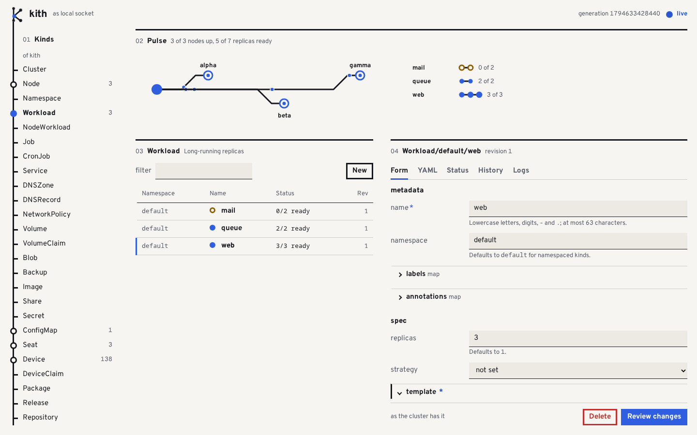
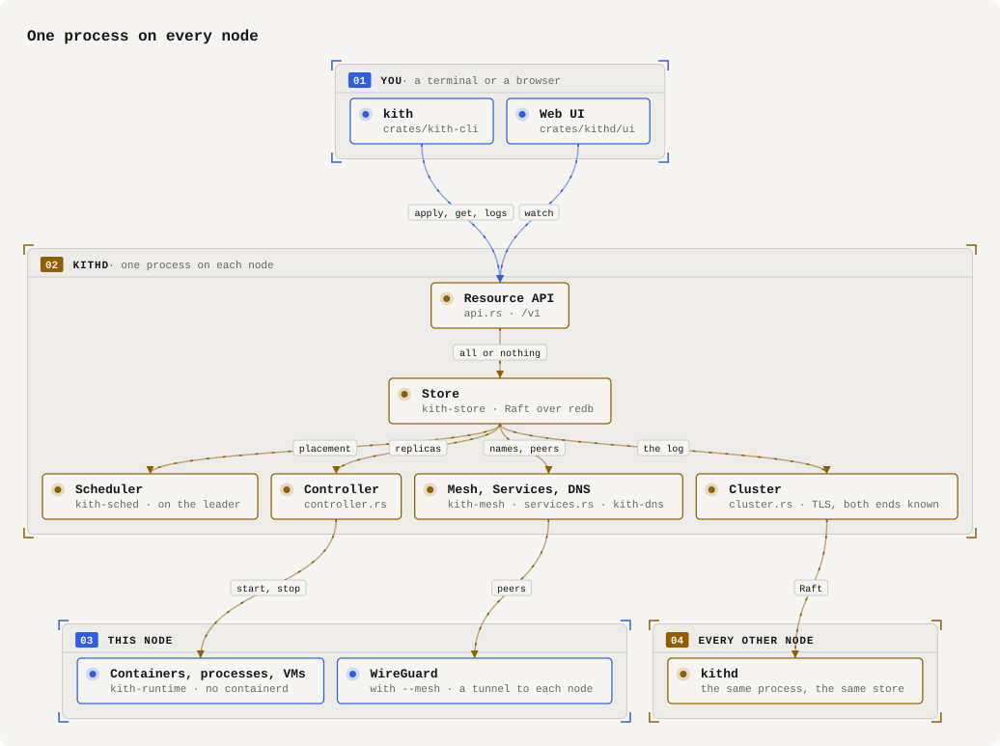
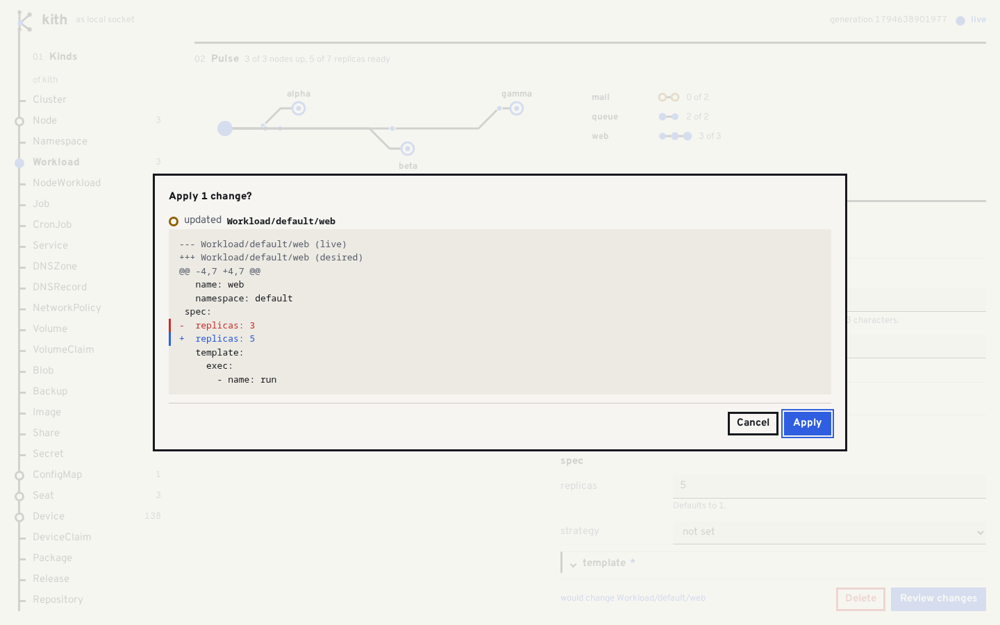
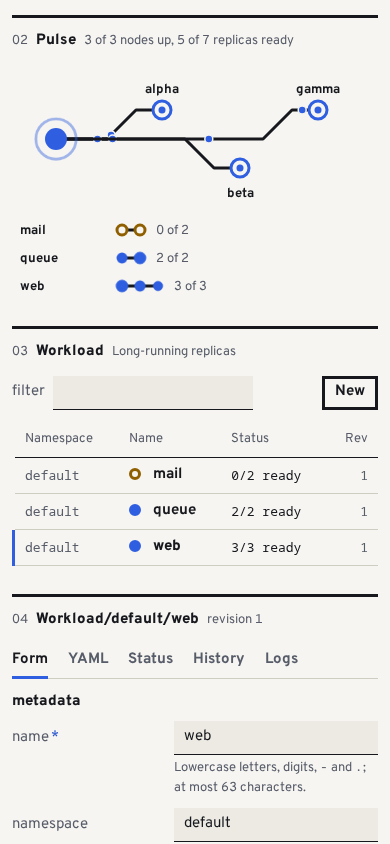
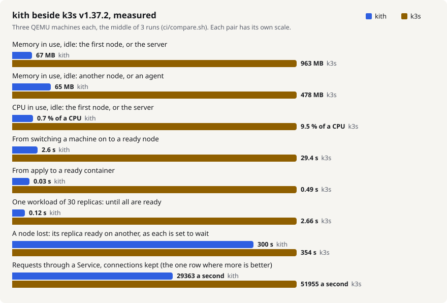

<p align="center"></p>

> **kith** *(n.)* one's close circle; the people you trust.

A tiny, immutable operating system that turns all of your machines into one
cluster, configured entirely through declarative resources. On every node one
process, `kithd`, is the API, the store, the scheduler and the container
runtime (under 13 MB, a budget the build is held to); `kith` is the command you
drive it with.

<picture>
  <source media="(prefers-color-scheme: dark)" srcset="docs/ui-dark.png">
  
</picture>

A page that shows it, with every number measured: <https://chasesunstrom.github.io/kith/>.
The design is in [PLAN.md](PLAN.md); what was read for security, and what kith
does not defend against, in [SECURITY.md](SECURITY.md).

## First run

On one Linux machine, as you: no root, an existing distribution (it needs
cgroup v2 and a systemd user session, which a current desktop or server has)
and a Rust toolchain. Most of the time it takes is the build.

1. Build the two programs and put them on your path.

   ```sh
   cargo build --release
   export PATH=$PWD/target/release:$PATH
   kith --version
   ```

   You should see `kith 1.0.0`.

2. Start the daemon.

   ```sh
   kithd &
   ```

   You should see `kithd: serving …/kithd.sock` (a socket under `/run/user/`
   that only you can open), and after it where the state is kept.

3. Apply the smallest example: one container that says hello every five
   seconds ([examples/hello.yaml](examples/hello.yaml), 14 lines).

   ```sh
   kith apply -f examples/hello.yaml
   ```

   You should see `Workload/default/hello created (revision 1)`.

4. Look at what there is. The first time its image is pulled, which takes a
   few seconds; ask again until it is ready.

   ```sh
   kith get
   ```

   You should see `hello  1         1/1 ready`.

5. Read what it says.

   ```sh
   kith logs workload/hello
   ```

   You should see `hello from w_default_hello_0_main`, a line for every five
   seconds it has run.

6. Open the web UI: the picture above, with your one Workload in it.

   ```sh
   kith ui
   ```

   You should see `http://127.0.0.1:…/ui/`. Open that address in a browser on
   the same machine; ctrl-c ends it.

7. Take the Workload away again.

   ```sh
   kith delete workload/hello
   ```

   You should see `Workload/default/hello deleted`.

That is all of it on one machine. `kill %1` stops the daemon; what you applied
is still there when it starts again.

## What do you want to do?

| To | Read |
|---|---|
| Run containers, plain processes and jobs, and change them safely | [What kithd does today](#what-kithd-does-today) |
| Make several machines one cluster | [More than one node](#more-than-one-node) |
| Give what runs a name, inside and outside | [DNS](#dns); a host of its own with a certificate: [More than one node](#more-than-one-node) |
| Say a thing once: names, functions and imports instead of YAML repeated | [kith's own language](#kiths-own-language) |
| Install an app with its settings, and upgrade it | [Packages](#packages) |
| Keep a cluster in step with a git repository | [Sources (GitOps)](#sources-gitops) |
| Bring manifests or a chart over from Kubernetes | [Importing from Kubernetes and Helm](#importing-from-kubernetes-and-helm) |
| Add a kind of your own, with its controller | [Kinds of your own](#kinds-of-your-own) |
| Let other people and programs in, each with their own rights | [Who may do what](#who-may-do-what) |
| Hand out GPUs and seats, run virtual machines | [Hardware](#hardware) |
| Keep data: volumes, shares, replicas, backups | [Storage](#storage) |
| See it and change it in a browser | [Web UI](#web-ui) |
| Make a machine nothing but a node, and keep it updated | [kith OS](#kith-os-kithd-as-the-machines-first-process) |
| Know what it costs beside Kubernetes | [Beside k3s](#beside-k3s) |
| Find your way in the code and test it | [Layout](#layout), [Development](#development) |

## How it works

<picture>
  <source media="(prefers-color-scheme: dark)" srcset="docs/assets/diagrams/architecture-dark.svg">
  
</picture>

You say what should exist, in files; `kith apply` sends them to a node, which
takes all of them or none. Everything else is `kithd` making its node match:
on the node that leads the store the scheduler says which node runs each
replica, and every node's controller starts and stops what is its own, with no
container daemon in between. With more than one node the store is copied to
the others by Raft; started with `--mesh`, the nodes also set up WireGuard
tunnels between themselves, over which what runs on one node reaches what
runs on another.

## Status

Every phase of the plan has been worked through, and the tree is at version
1.0.0: `kith.dev/v1` [is stable](#kithdevv1-is-stable). No release has been
tagged. Each section below says what works and, under "Not yet", what does not
(some of it named by the plan); what was read for security,
and what kith does not defend against, is in [SECURITY.md](SECURITY.md).

`kithd` runs as a service on an existing Linux distro (agent mode), or as the
first process of [kith OS](#kith-os-kithd-as-the-machines-first-process); on
one machine, or on several [joined into a cluster](#more-than-one-node). It owns
the store and keeps the containers, processes and machines on its node matching
the resources you apply. The [first run](#first-run) is one node in agent mode;
beyond it, everything goes through the same few commands:

```sh
kith get workload/hello -o yaml  # status: each container's state, restarts and last exit code
kith get -w workload             # the table, then each row as it changes (a long-poll on GET /v1/watch)
kith logs workload/hello -f      # its output, as it arrives
kith lint -f examples/           # validate files; needs no daemon
kith diff -f examples/           # what apply would change; exits 1 if anything
kith apply -f examples/          # all or nothing
kith history workload/hello
kith rollback workload/hello --to 1
kith schema                      # the 33 built-in kinds; `kith schema workload` prints its JSON Schema
```

Mistakes are reported with the file, line and column:

```
web.yaml:7:13: invalid type: string "yes", expected u32
  |   replicas: yes
  |             ^
```

## What kithd does today

- Serves the resource API as HTTP/JSON on a unix socket only you can open
  (`$XDG_RUNTIME_DIR/kith/kithd.sock`; `--socket` or `KITH_SOCKET` to move it).
  `kith` gives up on a kithd that has not answered for 30 s (`--timeout` or
  `KITH_TIMEOUT`, in seconds); a change that timed out may still have been applied.
- One kithd per state directory: a second one is refused instead of left waiting.
- Keeps resources and their revision history under `~/.local/state/kith/raft`
  (`--state` or `KITH_STATE`): a log of changes that is synced to disk before a
  change is answered, and a snapshot of the store now and then. It is the same
  replicated store a cluster uses, with this node as its only member. A
  `store.json` left there by an older kithd is brought in on the first start.
  `kith --store FILE` reads or edits a store kept in a plain file, with no
  daemon: for trying things out, not for looking into a kithd's state.
- Runs each `Workload` container in its own cgroup with youki's `libcontainer`
  linked in: no containerd, no shim, no root. Images are pulled into a
  content-addressed store; one pulled before starts without asking the registry
  (about 25 ms from `kith apply` to first output here), so `pullPolicy: always` is
  how you follow a tag that moves. Memory and CPU limits, `command`/`args`, and `env`
  from values, `ConfigMap`s and `Secret`s are honoured; containers that exit are
  restarted according to `restartPolicy`, with a backoff of up to a minute.
- Runs `exec` units next to containers: a plain process of the host (its files,
  its network, your user) in its own cgroup with the same limits and restart
  policy, for host-level tools. Whatever it forks is stopped with it.
- Runs each `Job` to completion: `completions` runs of its template,
  `parallelism` at a time (1 unless you say). A run fails as soon as one of its
  units exits non-zero or cannot start, and is tried again after a backoff;
  `retries` failed runs are forgiven (3 unless you say), one more fails the Job,
  and so does taking longer than `timeoutSeconds`. `kith get job` shows
  `running`, `succeeded` or `failed: <why>`. A finished Job runs again only when
  you change it; one that kithd was restarted under starts over.
- Keeps each unit's output: `kith logs KIND/NAME` prints it, with `--unit`,
  `--replica` (or the run of a Job), `--stderr`, `--tail LINES` and `-f` to
  follow until the unit is done. A log file that passes 10 MiB (`kithd
  --log-cap BYTES`) is moved aside, one old copy is kept (`kith logs
  --previous`), and deleting the Workload or Job deletes its logs.
- Probes containers: `readiness` decides whether a replica counts as ready, and
  a `liveness` probe that fails `failureThreshold` times in a row (3 unless you
  say) gets the container restarted, once it has passed for the first time
  (there is no start deadline yet). `tcp` and `http` probes are made against
  `localhost`, every `intervalSeconds` (10) and once a second until the first
  success.
- Updates a changed Workload one replica at a time: the next one is replaced
  only once the others are ready, so an update that does not come up stops at
  its first replica and the status says where. `strategy: recreate` replaces
  everything at once. A container or exec unit is replaced the same way when a
  `ConfigMap` or `Secret` value in its `env` changes.
- On SIGTERM it stops everything it started.

Not yet: `exec` probes are accepted but do nothing (the status says so), a
container's `ports` only name them for probes and Services (nothing is opened or
mapped: containers share the host's network), a replica is stopped before
its replacement starts (so `replicas: 1` is down for a moment during an update;
`blueGreen` is treated as rolling), containers share the host's
network and a read-only image (tmpfs on `/tmp` and `/run`), pulls are anonymous, and layers
must be gzip or plain tar. The log cap
is checked every 10 s, so a file can pass it by what its unit writes in that
time, and output written in the instant a file is moved aside is lost. As a service on a
distro, running as root is untested (on kith OS kithd is root: it is the first
process).

[`dist/kithd.service`](dist/kithd.service) is a systemd user unit for it; it has
not been run under systemd yet.

### What a container is kept from

Every container is started the same way, whatever it is for, with nothing to say:

```yaml
apiVersion: kith.dev/v1
kind: Workload
metadata:
  name: web
spec:
  template:
    containers:
      - name: web
        image: registry.example/shop/web:1
        signedBy:                  # run only if signed by one of these keys [whoever made it]
          - |
            -----BEGIN PUBLIC KEY-----
            MFkwEwYHKoZIzj0CAQYIKoZIzj0DAQcDQgAERhDxn4VReZhiLBr2unWdvMY/ZNKC
            MGaYlOciQKQ+hYdtBvtUrt5fB1yFOSdyVJyZGQsBVEz8puMa+EcnvEXHIg==
            -----END PUBLIC KEY-----
        runAsUser: 1000            # [the image's User; 65534 if it names none, or root]
        seccomp:
          allow: [ptrace]          # refused calls it may make after all [none]
```

- **Who it is.** The user its template names (`runAsUser`, a number, the group the same),
  else the image's `User` (a name is looked up in the image's own `/etc/passwd`), else
  nobody (65534). An image cannot make its container root by saying so: one that names
  root, or 0, gets nobody too (and one that names root's group, the user's own number
  as its group), and `runAsUser: 0` is how a container is root. Where kithd
  is your own service the container is a user namespace in which that user is the only
  one there is (on the node, its files are yours), and root, when asked for, is root of
  that namespace alone. It is still in your groups there (a namespace made without
  privileges cannot leave them), for what that is worth to it: the files it can reach
  are its image, its volumes and the devices it claims. On kith OS, where kithd is root, there is no user namespace yet:
  the container is that user of the node, and `runAsUser: 0` is the node's root with
  three capabilities (to send signals, to take a port below 1024, to write the audit log).
- **Nothing more than that user.** No capabilities (on kith OS the one for ports below
  1024 is kept), and no way to any: `no_new_privs` is set, so a setuid program in the
  image is an ordinary program.
- **Its image is read-only**, with a tmpfs on `/tmp` and on `/run`. A volume it mounts to
  write is given to its user where kithd is root: all of it, the first time and whenever
  the volume's directory is someone else's (a volume from before containers had users,
  a restored one, a workload whose user changed), walked without following a link. Two
  workloads that write one volume should be one user: each start would take it back. A
  directory of the host's that you named (a `kith-system` Volume) is left as you made it,
  and so is a volume mounted `readOnly`.
- **A filter on its system calls** (seccomp) refuses these, as if it were not allowed
  them: `mount`, `umount2`, `pivot_root`, `open_tree`, `move_mount`, `fsopen`,
  `fsconfig`, `fsmount`, `fspick`, `mount_setattr`, `open_by_handle_at`; `unshare`,
  `setns`, `clone` when it makes a namespace, `clone3` (answered as a kernel without it
  answers, so a C library falls back on `clone`); `init_module`, `finit_module`,
  `delete_module`, `kexec_load`, `kexec_file_load`, `reboot`, `swapon`, `swapoff`,
  `acct`, `settimeofday`, `clock_settime`; `bpf`, `perf_event_open`, `userfaultfd`,
  `io_uring_setup`, `io_uring_enter`, `io_uring_register`, `add_key`, `request_key`,
  `keyctl`; `ptrace`, `process_vm_readv`, `process_vm_writev`, `kcmp`, `pidfd_getfd`.
  Everything else goes through. `seccomp: { allow: [NAMES] }` lets some of them through again (a
  debugger wants `ptrace`; a browser's own sandbox wants `unshare`, `clone` and
  `clone3`), and `seccomp: { unconfined: true }` is no filter. A 32-bit program on a
  64-bit node is stopped at its first call, the filter knowing only the node's own
  numbers: it needs `unconfined`.
- **Whose image it is.** With `signedBy`, the image is run only if one of those keys
  signed it, as `cosign sign --key` does: the signature is looked for in the image's own
  repository (the tag `sha256-DIGEST.sig`) and checked against the manifest's digest
  before any layer is fetched; an image for several machines may be signed as the list
  or as this machine's own. Keys are ECDSA P-256 (what `cosign generate-key-pair` makes)
  or Ed25519: the text of the `.pub` file, or the base64 in it. An image already on the
  node counts as signed only by the keys a signature of it was found by; `pullPolicy:
  never` with a key the node has not checked it against does not start. With no
  `signedBy`, an image is run whoever made it.
- **What it still reaches.** The node's network (and so every port on its loopback, and
  the sockets programs of the node listen on by name alone, without a file), the
  kernel through every call the filter lets by, and the devices it claims: a GPU's render
  node is a wide door into a kernel driver, and no filter here narrows it. All of this is
  for keeping an honest program's mistakes small. Untrusted programs belong in a VM
  ([Virtual machines](#virtual-machines)), which is what a `vms` unit is for.
- Not yet: no AppArmor or SELinux profile; no user namespace on kith OS; the filter is a
  list of what is refused, not of what is allowed, so a call the kernel gains later is let
  through until it is named here; signatures with a certificate instead of a key
  (cosign's keyless signing), a transparency log, and signatures kept as referrers of the
  image (cosign's newer bundle format) are not read; keys are named by each template,
  not once for a cluster or a registry; an `exec` unit is none of this: it is a process
  of the host. The user namespace of the first kind (kithd as your service) has been run;
  the kith OS kind has been run in VMs with the default user and with root.

## More than one node

```sh
kithd --listen 192.168.1.10:7443 --name alpha      # first start: makes the cluster's CA
kith node token                                    # on alpha: good once, for an hour
kithd --join 192.168.1.10:7443 --token TOKEN --name beta    # on the other machine
kith get node                                      # on either: alpha and beta, `ready at` their addresses
kith node status                                   # who leads the store, who votes
```

- Every node keeps its own copy of the store (Raft, with the log on disk in
  `<state>/raft`). A change made through any node goes to the leader, is
  written to disk by more than half of the voting nodes, and only then
  answered. What a node reads is its own copy, which can be a moment behind.
- From three nodes on, three of them vote, and the cluster goes on when one of
  those is lost: the other two pick a new leader within a few seconds. With
  two nodes (also after one of three is deleted) only one votes, because two
  voters would stop when either one did; losing it stops changes until it is
  back. A node starts to vote only once it has received the store.
- `kith delete node/NAME` takes a node out of the store's members.
- Every node tells every other one, every two seconds, which nodes it has
  heard from (none of this goes through the store). A node nobody has heard
  from for ten seconds shows as `unreachable` in `kith get node`, and as
  `ready` again when it is back. A voter that is unreachable for a minute
  gives its vote to a node that is there, if the cluster has one to spare.

- The node that leads the store says which node runs each replica of a
  Workload: one with room for what it asks for (`resources`), that matches its
  `placement`, is not cordoned or tainted, and spread over the nodes. `kith
  get workload/NAME -o yaml` shows where each one is (`nodes`), or why one
  has no home (`unschedulable`); `kith logs` reads a replica's output from
  whichever node has it. A Job is run by one node. A node is given nothing
  new until the leader has heard from it (a few seconds after it joins).
- A `NodeWorkload` runs one copy on every node whose labels match its
  `selector` (empty: every node), except cordoned and `NoExecute`-tainted
  nodes and ones lost past `--lost-after`. Label a node by editing it:
  `kith get node/NAME -o yaml`, add `metadata.labels`, `kith apply`. A node
  that starts to match gets a copy, one that stops loses it; `nodes` in
  `kith get nodeworkload/NAME -o yaml` says which copy (number) each node
  runs, `kith get` shows ready over the number of nodes, and `kith logs
  nodeworkload/NAME --replica N` reads a copy's output. On one node (no
  cluster) it runs one copy if the selector is empty, none otherwise.
- A replica stays on its node. When the node has been unreachable for five
  minutes (`--lost-after SECONDS`), its replicas are started on other nodes,
  and stay there when it comes back; a Job it was running starts over.
  A node that restarts runs nothing until it has caught up with the store
  (it may have lost replicas while it was away), so not while the cluster has
  no leader.

- Nodes talk over TLS and both ends show a certificate from the cluster's CA:
  that proves membership, not which member (every node trusts every other).
  Without one, a caller can read the CA certificate and present a join token,
  nothing else, and is cut off after 15 s.
- The token carries the CA's fingerprint: a joining node checks who it is
  talking to before it sends the token's secret.
- A node keeps its identity in `<state>/pki`; after the first start it needs
  neither `--join` nor `--token`.
- With `--mesh` (optionally `--mesh 51820`, the UDP port) a node joins the
  cluster's WireGuard mesh: kithd makes the interface `kith0`
  (`--mesh-interface NAME`) itself, with no `wg` or `ip`, which takes the
  kernel's WireGuard and CAP_NET_ADMIN (without them kithd says so and runs
  without a mesh). Every node gets a stable IPv6 address worked out from the
  cluster's CA and its own name, `kith get node/NAME -o yaml` shows it and
  the node's public key (`mesh`), and `kith node status` lists the peers and
  when each last shook hands. The private key stays in `<state>/pki`.
  Peers are reached at the address the cluster knows them by. One that has
  not answered for three minutes is reached through a node with the `edge`
  role instead, and directly again when it answers; the edge node's machine
  has to forward (`net.ipv6.conf.all.forwarding=1`, kithd warns if it does
  not and leaves the setting alone), and it sees what it passes on. kithd
  takes over a WireGuard interface of that name that is already there (its
  key and peers are replaced; one that is not WireGuard is refused) and
  removes the interface when it stops. `sh ci/mesh_rtt.sh` measures what the
  mesh adds to a round trip between two namespaces on a veth (not a LAN): +0.08 to
  +0.15 ms over the veth's 0.03 ms in five runs here, against the plan's 0.3 ms.
- A laptop is a node that comes and goes. Join it as one:

  ```sh
  kithd --join HOME:7443 --token "$(…)" --mesh --roaming
  ```

  It tells the cluster its mesh key as it joins and is told which nodes to
  call; from then on the cluster talks to it at its mesh address, through the
  tunnel the laptop opens from wherever it is, not at the address it joined
  from. A roaming node never starts to vote (it leaving must not cost the
  cluster its majority), and what it runs stays its own however long it is
  away: nothing is started elsewhere after `--lost-after`, and nothing new is
  placed on it until it is back. That is for ever: for a laptop that is gone
  for good, `kith delete node/NAME`, or take `roaming` off its Node. (`spec.roaming: true` on the Node; a node
  that joined without the flag keeps the address it joined with.)

  For this the laptop has to be able to call at least one node directly: one
  with a public address, or with UDP port 51820 forwarded to it at home. Two
  nodes that are both behind NAT only meet through an edge node (no hole
  punching yet), and an edge node sees what it passes on. If that is not
  acceptable, say so on the Node:

  ```yaml
  spec:
    roaming: true
    mesh: { relay: never }   # straight to the other node, or not at all
  ```

  Its traffic is then never passed on by an edge node, whichever end asks: a
  peer it cannot reach directly is unreachable until it can. `kith node
  status` says of each peer whether it is `direct`, `through an edge node` or
  `unreachable`. The tunnels are WireGuard between the two nodes' own keys,
  which never leave them, and what goes through them between kithds is TLS
  with the cluster's certificates as well.
- On the mesh a `Service` has an address of its own, the same on every node
  (`kith get service/NAME -o yaml` shows it and the number of ready replicas
  behind it), and the name `<service>.<namespace>.kith` where kithd answers
  DNS. A TCP connection from a node to that address and one of the Service's
  ports goes to a ready replica of the Workloads its selector matches, each
  in turn, on whichever node it runs: kithd passes the bytes on, over the
  mesh if the replica is elsewhere, to the replica's port on its node's
  `127.0.0.1` (or `::1`). A kithd that restarts drops the connections through
  it. Only TCP; a `targetPort` by name is a container port of that name.
- A `NetworkPolicy` says who may connect to the Workloads it selects through
  a Service: the first ingress rule that fits decides, and when a policy
  selects a Workload and no rule fits, the connection is refused. A peer is
  told by `node` (the node the connection comes from) or `cidr`. Peers by
  `namespace` or `selector` cannot be told apart yet (an allow rule for them
  lets nobody in, a deny rule keeps everybody out) and egress rules are not
  enforced; the policy's status says `partial` and why, `enforced` otherwise.
  A policy does not stop a connection that goes to a node's own address
  instead of the Service's.
- With `--ingress` (and `--mesh`; meant for nodes with a public address) a
  node answers HTTPS on port 443 for every Service with `expose`, by the host
  the client asks for, and passes the connection on to the Service (its first
  TCP port); port 80 sends browsers to HTTPS. Binding the two ports takes
  CAP_NET_BIND_SERVICE. A host's certificate is the Secret `tls-<host>` next
  to its Service (`tls.crt` and `tls.key`, PEM): apply your own, or start the
  node with `--acme` and kithd gets one from Let's Encrypt (`--acme URL` for
  another ACME directory; giving the flag agrees to that authority's terms)
  and another before it runs out. The host's DNS has to point at the ingress
  nodes first: the authority checks by asking port 80 there, and any node
  with `--ingress` can answer. `kith get service/NAME -o yaml` shows how it
  went (`tls`: its `secret` names the Secret whose certificate serves the
  host, one applied by hand included); after a failure kithd tries again an
  hour later, not sooner.
  TLS ends at the ingress and the bytes go on as they are: no header is added,
  and to a NetworkPolicy the connection comes from the ingress node. With
  `expose.proxyProtocol: true` the backend is sent a PROXY protocol v1 line
  (`PROXY TCP4 <client> <ingress> <client port> <ingress port>`) with the
  client's address before the client's bytes; it is off unless asked for,
  because a backend that does not expect the line will break on it. Only the
  ingress sends it: a client inside the mesh that calls the Service gets
  none, so the backend has to take both. Certificate keys and the ACME account key
  (`Secret/kith-system/acme-account`) are in the store like other Secrets.
  `expose.host` has to be a domain name a certificate authority issues for:
  an IP address, a label that starts or ends with `-`, or a `_` is refused
  when applied. Two Services with one host: the older has it, and the other's
  status says `expose: refused` and why. Until a host is kept for a namespace,
  whoever may write a Service anywhere has it by being first: a Namespace
  with `spec: { hosts: ['*.example.org', example.org] }` (a name, or `*.` and
  a domain for every name under it; YAML wants the `*` quoted) keeps those
  for its own Services, whichever came first, and exposes no others; a
  Service that asks otherwise is refused the same way, and no certificate is
  ordered for it. Each port takes 1024 connections at
  a time, 64 of them from one source (an IPv4 address, or an IPv6 /64); more
  are hung up on. One with no byte either way for 5 minutes on 443 is closed,
  and one on 80 after 30 seconds whatever it does. Inside the mesh, a node
  passes on 4096 connections to Services at a time (1024 for any one other
  node), and one that is silent both ways for an hour is closed.

What a cluster of three does when a node is cut off or loses power is tested
in VMs (`sh ci/vm.sh --test chaos`): three kith OS nodes, and a writer on the
host through each of them. Each node in turn has its card on the cluster's
network unplugged for a while; each node in turn is reset by the hypervisor
in the middle of writes. Every time the other two go on taking writes, and the
node that is cut off acknowledges none. Then all three are reset at the same
moment, so that no node has what another lost. At the end every write that
was acknowledged is on all three nodes, which hold the same. A reset by the
hypervisor loses what the guest had not yet handed to its disk and nothing
else: a disk that says it flushed and did not, a write torn in half, delay
and loss on the network, and real machines are not what this shows.

Not yet: nodes that do not roam still talk to each other at their plain
addresses, not over the mesh, workloads have no addresses of their own on it (a
Service has one), and two nodes that are both behind NAT only reach each other
through an edge node.
Replicas of one Workload on different nodes are all replaced at once
when it changes (on one node it is one at a time; a `NodeWorkload` is always
replaced all at once), and replicas on a node that is unreachable still count as ready until it has been
so for `--lost-after` (five minutes); a roaming node's count as ready however long it is away. A change whose answer was lost with the leader may or may not have
happened; `kith get` tells. Joining needs an empty `--state`. A joined node
that moves to another address has to be deleted and joined again.
Only the first node can admit others, tokens do not survive its restart (and
`--token` shows in the process list until then: `KITH_TOKEN` does not), a join
that dies halfway needs `kith delete node/NAME` and a new token,
certificates last ten years and cannot be renewed or revoked, and `kith` itself
only talks to the kithd on its own machine.

## DNS

```sh
kithd --dns 192.168.1.10:53          # UDP and TCP; port 53 needs root or CAP_NET_BIND_SERVICE
kith apply -f examples/dns.yaml      # a DNSZone and two DNSRecords
dig @192.168.1.10 nas.home.example   # 192.168.1.20
kith get dnsrecord                   # each one says `served`, or why not
```

- `<node>.node.kith` is the address each node of the cluster is reached at,
  `<node>.mesh.kith` its address on the mesh (if it is on it), and
  `<service>.<namespace>.kith` a Service's address on the mesh (where the
  node asked is on it). Names under `kith` are the cluster's own: a zone
  cannot take them.
- A `DNSZone` is a domain kithd answers itself; a `DNSRecord` is a name in one:
  A, AAAA, CNAME, TXT, SRV, NS or PTR, `*.apps` for a wildcard, `@` for the
  zone itself. Names in values are full names (`nas.home.example`).
- Split horizon: a zone with `clients: [192.168.0.0/16]` is what those clients
  get, in place of a zone for everyone with the same domain. A client inside
  two different `clients` lists gets only one of them, the list with the
  longest matching prefix (`10.1.2.0/24` beats `10.0.0.0/8`; equal prefixes
  go to the list that sorts first): give zones that belong together the same
  list.
- Every other name is passed to the resolvers in `/etc/resolv.conf`
  (`--dns-upstream 1.1.1.1,9.9.9.9` to say which), for clients on private
  networks only, so a kithd reachable from the internet is not an open
  resolver. Point your router's DHCP at a node and the whole house uses it.
  A CNAME in a zone to a name outside it is answered with the target's
  addresses from those resolvers too, so stub resolvers get one reply to use
  (the CNAME alone when they do not answer).
- In a cluster every node started with `--dns` answers the same names.

Not yet: DNSSEC, zone transfers, and caching of upstream answers.

## Packages

A package is a directory of resource templates with default values
([`packages/web`](packages/web) is one):

```text
package.yaml          name, version, description, kithVersion, dependencies
values.yaml           the default values
values.schema.json    what values may be (optional)
templates/*.yaml      resources, as templates; files named _something are only included
NOTES                 what to tell whoever installed it (optional; a template too)
```

```sh
kith package lint packages/web
kith package render packages/web --name shop -n store --set replicas=3 -f mine.yaml
kith package render packages/web --name shop | kith apply -f -
```

- Templates are Jinja ([minijinja](https://docs.rs/minijinja)). They see
  `values` (the defaults, with each `-f` file and then each `--set` on top,
  merged key by key), `release.name`, `release.namespace`, `package.name`,
  `package.version`, `name` (a name for the release's resources:
  `shop-web`) and `labels`. `{{ value | toYaml | indent(4) }}` writes a value
  as YAML, `{{ value | tojson }}` quotes one that could be anything, and
  `required(value, "why")` stops with `why` when there is none. Using a value
  that is not there is an error, and so is a template that never ends or
  writes more than 1 MB. A template reads nothing but its package (links in
  the package's directory are not followed), and `namespace()` is not there.
- What comes out is checked like any resource (an error shows the rendered
  text's line), put in the release's namespace unless it names one, and
  labelled `kith.dev/release` and `kith.dev/package`.
- Values are checked against `values.schema.json`, of which kith knows
  `type`, `properties`, `required`, `additionalProperties`, `items`, `enum`
  and the `minimum`/`maximum` family; `lint` says so about any other keyword.

### Releases

A cluster installs a package itself: push the package, apply a `Release`.

```sh
kith package push packages/web      # the package, as Package/web-0.1.0 in the store
kith apply -f release.yaml
kith get release/shop -n store -o yaml   # status: state, version, resources, notes
```

```yaml
apiVersion: kith.dev/v1
kind: Release
metadata: { name: shop, namespace: store }
spec:
  package: { name: web, version: 0.1.0 }   # no version: the newest pushed
  values: { replicas: 3 }
```

- The node that leads the store renders the package and applies what comes
  out; a change to the Release, to the package or to shared values is rendered
  and applied again, and what is no longer rendered is deleted. Deleting the
  Release deletes what it installed. `kith rollback release/shop --to N`
  goes back to an earlier Release, and so to what that installed.
- Values, later over earlier: the package's defaults, the key `values` (YAML)
  of the ConfigMap `kith-system/kith-values`, the same in the Release's
  namespace, the Release's `spec.values`.
- What a release installed is annotated `kith.dev/owned-by` with the Release's
  key and listed in the Release's status; only what is both is deleted when
  it is no longer rendered, and everything so annotated goes when the Release
  does (so `kith apply` refuses a resource annotated as a Release's when
  there is no such Release). A release does not take over a resource that is
  there already and not its own, stays in its own namespace, and makes
  nothing that is in no namespace (a Node, a Package), no Release or Source,
  and no `kith-values` ConfigMap; any of these (or a template that fails) is
  `state: error` with the reason in `message`, and what was installed before
  stays as it was.
- `version` is one version (`1.2.0`) or a range (`^1.2`, `>=1, <3`); none is
  any version that is not a pre-release. A Release goes on the newest
  package that fits and stays on it; with `autoUpgrade: true` it follows
  newer ones as they come. Pushing a version again replaces it.

### Repositories

Packages travel as OCI artifacts in any registry, signed:

```sh
kith package keygen signing.key        # the secret into the file; prints the public key
kith package push packages/web --to oci://registry.example/packages --key signing.key
kith package pull oci://registry.example/packages web 0.1.0 --public-key 3f9c…
```

```yaml
apiVersion: kith.dev/v1
kind: Repository
metadata: { name: ours }
spec: { url: oci://registry.example/packages, publicKey: 3f9c… }
---
apiVersion: kith.dev/v1
kind: Release
metadata: { name: shop }
spec:
  package: { repo: ours, name: web, version: ^0.1 }
  autoUpgrade: true
```

- The package `web` is the repository `packages/web` there, each version a
  tag. The artifact is one blob (the package's files) and a signature
  (Ed25519, over the package's name, version and the blob's SHA-256) as the
  annotation `dev.kith.signature`.
- For a Release that names a Repository, the node that leads the store asks
  the registry for the versions, fetches the newest that fits, checks it
  against the Repository's `publicKey` and stores it as a Package (annotated
  `kith.dev/repository`); the Release installs only Packages from its
  Repository. A package that is unsigned or signed with another key is
  refused, and the Repository's status says so (`state: error`, `message`).
  A newer version that does not check out is passed over for the newest
  that does (the status says which). A Repository without a `publicKey`
  takes packages as they come. Change a Repository's `url` or `publicKey`
  and what was fetched before is no longer taken for its: it is fetched and
  checked again.
- A Package keeps its last 3 revisions (other kinds keep 100), because it
  carries its files; push a new version rather than rolling far back.
- A version is fetched once: pushing it to the registry again changes
  nothing here. A registry can also keep quiet about newer versions; the
  signature says a package is the publisher's, not that it is the newest.
- Registries are asked when a Release wants something new and every
  `--repository-poll` seconds (300) for Releases with `autoUpgrade`.
- `kith` reaches a registry through kithd (push and pull need a running
  kithd). No registry logins yet; plain HTTP only to a registry on the same
  machine.

Not yet: `dependencies` are read and nothing more; no hooks, no looking up
what is in the cluster from a template, no registry credentials.

### A desktop is a package

kith has no desktop of its own, and a node nobody gives one stays headless.
Four example packages show the shape ([`packages/hyprland`](packages/hyprland),
[`packages/gnome`](packages/gnome), [`packages/kiosk`](packages/kiosk),
[`packages/kith-panel`](packages/kith-panel)):

```sh
kith get seat                       # office-pc-seat0
kith package render packages/hyprland --name office -n desktop \
  --set seat=office-pc-seat0 --set image=registry.example/me/hyprland:1 | kith apply -f -
```

- Each session package renders a `DeviceClaim` for the seat (exclusive) and a
  `Workload` of one replica that holds it; see [Hardware](#hardware) for what
  a seat is. `reserve` is the container's CPUs and memory.
- kith ships no desktop images: `image` names one you built or trust. The
  session's container is told `KITH_SEAT`, `KITH_USER`, and (Hyprland, GNOME)
  `KITH_APPS` and `KITH_DOTFILES`; the kiosk runs `command`. It runs as the image's
  `User`, like any container ([What a container is kept from](#what-a-container-is-kept-from)):
  give the image the user the session is to be, since it is not started as root to become
  one. The seat's device nodes are that user's (on kith OS).
- `kith-panel` is a plain `Workload` for a panel image, placed by node labels
  (`require`).
- Delete the release and the node is headless again.

## Sources (GitOps)

A `Source` keeps what is in a git repository (or an OCI artifact) applied:

```yaml
apiVersion: kith.dev/v1
kind: Source
metadata: { name: cluster, namespace: kith-system }
spec:
  git: { url: https://example.org/ops/cluster.git, rev: main }
  path: clusters/home        # the YAML and JSON files under it
  intervalSeconds: 60
  prune: true                # delete what the source no longer has
  approval: manual           # hold each new revision until approved [auto]
```

```sh
kith get source/cluster -n kith-system -o yaml   # status: state, revision, pending, drift
kith source approve cluster -n kith-system       # apply the revision that waits
kith source push conf --to oci://registry.example/sources/conf:v1   # for `spec.oci`
```

- The node that leads the store fetches the source every `intervalSeconds`
  (5 at least) and applies its resources, marked `kith.dev/owned-by` like a
  Release's. A resource that names no namespace goes in the Source's. A
  Source applies only into its own namespace; one in `kith-system` applies
  anywhere and any kind (it is the cluster's own). It does not take over what
  is there and not its own; of two Sources that name one resource the one
  that has it keeps it (the first by name, if they come together) and the
  other says `error`. Sources are fetched several at
  once, and one that keeps failing is fetched less and less often (its
  interval doubled each time, to an hour).
- `status.state` is `synced` (at `revision`), `pending` (`pending.revision`
  waits for `kith source approve`, with what it would change) or `error`
  (with `message`; what was applied stays). When the source moves on, a
  manual Source waits again.
- What a Source applied and someone changed since is put back, and listed in
  `status.drift`: the source is what is true. Deleting a Source deletes what
  it applied.
- git is the node's `git` program (it must be installed), over `https://`
  or `ssh://` only, with no credentials but what ssh has; nothing is checked
  out, so links in a repository are skipped (`status.skipped`), and a
  source is 2000 files and 4 MB at most. git is run by `sh` (under `ulimit -f`)
  and writes no file over 256 MB; a repository that takes more is dropped.
- Only a Source in `kith-system` is fetched over `ssh://` (it is the node's
  own keys that open the door) or from this node and its own networks
  (loopback, private, link-local and shared addresses, by whatever name;
  any address one of this machine's cards has or a Node of the cluster
  advertises too).
  Any other Source is fetched from the very address that was checked: a name
  that answers differently a moment later, or a redirect, leads nowhere else
  (git follows none and needs to be 2.37 or newer; a registry's redirects
  and token host are each checked the same way).
- An approval is for a revision: a Source whose `path` or `prune` you change
  applies the revision already approved the new way.

Not yet: signed-commit verification, credentials for private repositories.

## Importing from Kubernetes and Helm

`kith import k8s -f manifests.yaml` (`-f -` reads stdin; `-f` may repeat; a
`List` is unwrapped) prints the kith resources the manifests translate to.
`kith import helm ./chart --name shop -n store -f values.yaml` runs your
installed `helm template` and translates what it prints (no helm: pipe
`helm template ... | kith import k8s -f -`). Review the output, then
`kith apply -f` it.

| Kubernetes | kith |
|---|---|
| Deployment, StatefulSet | Workload (a StatefulSet's `volumeClaimTemplates` become one shared VolumeClaim `<template>-<name>`) |
| DaemonSet | NodeWorkload |
| Service | Service |
| Ingress | `expose: {host, via: edge, proxyProtocol}` on the Service behind each host |
| ConfigMap, Secret | ConfigMap, Secret (`data` decoded from base64: the output holds the plain text) |
| PersistentVolumeClaim | VolumeClaim |
| Job, CronJob | Job, CronJob |

Nothing is dropped silently. Every field that is not carried over (an
`affinity`, a `securityContext`, an unknown kind, an object that would not
validate) is named on stderr by path, such as
`not translated: Deployment/web: spec.template.spec.affinity not translated`.
Status, `managedFields`, `uid`, `resourceVersion` and Helm's own labels are
ignored, not reported. Exit status: 0 everything translated, 1 something is
in the report (the output is still printed), 2 the input could not be read.
`nodeSelector` becomes a placement requirement, and a pod template's labels
are added to the workload's, since kith Services select on those.

## Kinds of your own

A `KindDefinition` makes a new kind. Resources of it are applied, listed,
watched, kept with their history and deleted like any other; what a kind
*does* is up to a controller that watches it.

```yaml
apiVersion: kith.dev/v1
kind: KindDefinition
metadata: { name: gameserver }
spec:
  group: games.example.com   # a domain of yours; with version, the apiVersion
  version: v1
  kind: GameServer
  namespaced: true           # [true]
  schema:                    # of the spec; the same subset as a package's values
    type: object
    required: [map]
    additionalProperties: false
    properties:
      map: { type: string }
      players: { type: integer, minimum: 1, maximum: 64 }
  columns:                   # what `kith get gameserver` shows
    - { name: Map, path: spec.map }
---
apiVersion: games.example.com/v1
kind: GameServer
metadata: { name: one }
spec: { map: dust, players: 8 }
```

- The store checks every write of such a resource against the schema, and
  says what is wrong by path (`spec.players: it must be at most 64`). In one
  `kith apply`, put the definition before what is of its kind.
- `kith get`, `delete`, `history`, `rollback` and `schema` take the kind's
  name in any case, like kith's own; `kith schema` lists the cluster's kinds
  after kith's.
- One definition per kind. A definition cannot be deleted, renamed to another
  kind or moved between namespaced and cluster-wide while resources of its
  kind exist. A changed schema is checked at the next write of each resource;
  what is stored stays as it is.
- A Source or a package may apply resources of a defined kind; a Source in
  `kith-system` may bring the definition along.

Not yet: several versions of a kind side by side, a schema for `status`.

### Controllers and admission, in WebAssembly

A kind can carry code: a **controller** that says what should exist because
of each resource of the kind, and an **admission** hook that is asked before
one is written. Both are WebAssembly modules that kithd runs itself, with no
container, image or credentials: a function from JSON to JSON that can reach
nothing else.

```rust
// sdk/kith-controller/examples/gameserver has all of it
use kith_controller::{Admit, Reconcile, Reconciled, Value, json};

fn reconcile(input: Reconcile) -> Result<Reconciled, String> {
    let name = input.resource["metadata"]["name"].as_str().ok_or("no name")?;
    Ok(Reconciled {
        status: json!({ "state": "ready" }),
        resources: vec![json!({
            "apiVersion": "kith.dev/v1", "kind": "ConfigMap",
            "metadata": { "name": format!("{name}-config") },
            "spec": { "data": { "map": input.resource["spec"]["map"] } },
        })],
    })
}

fn admit(input: Admit) -> Result<Option<Value>, String> {
    if input.resource["spec"]["map"] == "lava" {
        return Err("the map lava is closed".into());   // refused, with this reason
    }
    Ok(None)                                           // as it is; Some(resource) changes it
}

kith_controller::controller!(reconcile);
kith_controller::admission!(admit);
```

```sh
rustup target add wasm32-unknown-unknown
cargo build --release --target wasm32-unknown-unknown    # a cdylib depending on sdk/kith-controller
kith controller set GameServer --controller game.wasm --admission game.wasm
```

`kith controller set` puts the module in the kind's KindDefinition
(`spec.controller.wasm`, `spec.admission.wasm`, base64), so it is replicated,
kept in history and rolled back like the rest of the cluster's state.

- **The controller** runs on the node that leads the store, whenever the
  resource, the module, or something the resource owns changes. It is given
  `{resource, owned}` and answers `{status, resources}`. The resources are
  made so in the resource's namespace as its own (annotated
  `kith.dev/owned-by`), put back if someone changes or removes them, removed
  when no longer answered, and removed with their owner. It may make anything
  namespaced except a Release or a Source, including resources of other
  defined kinds, whose controllers then run in turn.
- Its `status` fields are recorded on the resource, with `resources` (what it
  owns) and `controller`: `{state: ok, observedRevision}` or `{state: error,
  message}`. A run that fails changes nothing and is tried again when
  something changes.
- **Admission** is asked about every apply of a resource of the kind through
  kithd, whoever makes it (`kith apply`, a Source, a Release, a controller),
  with `{resource, old}`. It may refuse (`refused by GameServer's admission:
  the map lava is closed`, also on `--dry-run`) or change the spec, labels
  and annotations; what it makes of the resource is then checked against the
  schema like any write. A hook that fails refuses the write.
- **Limits**, each ending that one call with the reason: a module of at most
  1 MiB, 50 million instructions' worth of fuel, 16 MiB of memory, 1 MiB of
  input and of answer. A module that imports anything does not start. Each
  call starts from a fresh instance: nothing is remembered between calls.
- Whoever may write KindDefinitions may run code in every namespace through
  them: grant that as you would grant admin.

Things to know: a rollback is asked of admission too (what it refuses does
not come back; what it would change comes back as it was); a delete is not
asked. At most four modules run at once, and a controller answers at most 64
resources. Applying
a KindDefinition's YAML again without its `controller`/`admission` removes
them (keep the YAML and the module together, or run `kith controller set`
after). `kith --store FILE`, which works on a file without kithd, runs
neither. A module sees one resource and what it owns; a controller that has
to look further is a Workload using the API.

In another language: export `memory`, `kith_alloc(len: u32) -> ptr`, and
`kith_reconcile` / `kith_admit` as `(ptr: u32, len: u32) -> u64`: JSON in at
`ptr`, and the answer's `ptr << 32 | len` out, `{"ok": …}` or `{"error":
"why"}`.

## Who may do what

On a node, whoever can open kithd's socket is the admin: `kith` there may do
everything. From anywhere else, a person or a program calls a node's TLS port
(`--listen`) as an **Identity**, with a certificate from the cluster's CA,
and may do what the **Roles** bound to it allow. Nothing, to begin with.
What each of them is trusted with, what kith does not defend against, and how
to report a hole: [SECURITY.md](SECURITY.md).

```sh
kith identity cert alice --out ~/alice    # on the node the cluster was started on
```

writes `alice.crt`, `alice.key` and `ca.crt`, and makes `Identity/alice` if it
is not there. Then say what she may do:

```yaml
apiVersion: kith.dev/v1
kind: Role
metadata: { name: web-editor }
spec:
  rules:
    - kinds: [Workload, Service, ConfigMap]   # or ['*']
      verbs: [get, list, watch, apply, delete]
      namespaces: [web]                        # left out: everywhere
---
apiVersion: kith.dev/v1
kind: RoleBinding
metadata: { name: alice-web }
spec:
  role: web-editor
  subjects: [alice]        # Identities by name, or `group:ops` for spec.groups
```

```sh
curl --cacert ca.crt --cert alice.crt --key alice.key \
     --resolve kith:7443:10.0.0.7 https://kith:7443/v1/resources?kind=Workload
```

(Every node's certificate is good for the name `kith`. `kith` itself only
talks to the local socket so far.)

A node nobody can log in to (kith OS has no shell) has no socket to run that
on. Start its kithd with `--claim`: while the cluster has no Identity, it
prints a token at each start,

```
kithd: nobody administers this cluster from outside yet. For an hour, whoever sends this token to /v1/claim does: kith1.<secret>.<the CA's fingerprint>
```

and whoever sends it first becomes an Identity that may do everything (a Role
`cluster-admin` is bound to it):

```sh
curl -k -d "{\"token\":\"$TOKEN\",\"name\":\"root\"}" -H 'Content-Type: application/json' \
     https://10.0.0.7:7443/v1/claim       # {"ca": …, "cert": …, "key": …}: save as ca.crt, root.crt, root.key
```

Once the cluster has an Identity, however it was made, the token claims
nothing. The token is good once, for an hour, and for nothing else (it admits no node,
and a join token claims nothing). `-k` there means curl does not know the
node yet: the token's last part is the SHA-256 of the cluster's CA, so to be
sure nobody sits in between, fetch `https://10.0.0.7:7443/v1/ca` first,
compare `openssl x509 -noout -fingerprint -sha256` of it with that part, and
claim with `--cacert` instead. The token is on the node's console: who can
read that, or its logs, within the hour can claim the cluster.

Such a cluster has no socket to ask for a join token either, so its admin
asks over TLS: `curl --cacert ca.crt --cert root.crt --key root.key -X POST
https://10.0.0.7:7443/v1/tokens`. A node may do everything in its cluster, so
this is only for an Identity that may apply Nodes, Roles and RoleBindings:
one that could give itself every right anyway.

- What is not allowed is refused with 403 and the reason. `list` and `watch`
  show what the caller may see and no more. An apply is all or nothing: one
  resource it may not apply refuses the whole body.
- `get` covers a resource, its history and its output (`/v1/logs`); `apply`
  covers rollback; pushing to or pulling from a registry through kithd takes
  `apply` on `Package` (kithd then calls whatever registry is named: grant
  it to those you would let do that).
- A rule that names namespaces says nothing of kinds that are in none (Node,
  Role, KindDefinition…): those take a rule without `namespaces`.
- The certificate stands for the Identity while the Identity's `publicKey` is
  the certificate's key. `kith identity cert` again gives a new key and ends
  the old certificate's access; `kith delete identity/alice` ends it all.
- Grant with care: `apply` on Role, RoleBinding or Identity is the power to
  grant oneself anything, and whoever may apply a Workload runs programs on
  your nodes. A Release or Source acts for the cluster, not for whoever
  applied it.

Every change made through a node, and every refusal, is one line in that
node's audit log (`audit.log` in its state directory, 4 MB and the four
files of 4 MB before it, `audit.log.1` to `.4`): when, who, what, and how it
went. A certificate that no longer stands for its Identity is a refusal too,
and so is no certificate at all (one line a minute of those). Refusals past
sixty a minute are counted rather than written. A watch ends when its
Identity is deleted or given another certificate. `Audit` is not a name a
custom kind may take. Permission is asked when a request arrives, not again
when its write is committed: a Role removed in between does not stop a write
already under way. `kith audit` shows the last of it,
as does `GET /v1/audit` for an Identity with `get` on `Audit`.

```
WHEN                  WHO           DID     WHAT                            OUTCOME
2026-11-12T10:02:11Z  local socket  apply   Role/web-editor                 ok
2026-11-12T10:03:40Z  alice         apply   Workload/web/site               ok
2026-11-12T10:03:55Z  alice         delete  Node                            alice may not delete Node: no Role bound to it allows that
```

Not yet: `kith` over TLS, logging in through an identity provider (OIDC),
certificates that expire before ten years, one audit log for the cluster.

## Hardware

Every node of a cluster lists its own hardware from `/sys` and keeps one `Device`
per piece of it in the store, applied when it turns up and deleted when it is
gone (a rescan every half minute, not hot-plug events: a plugged device shows
within 30 seconds). `kith get device` lists them.

- A `Device` is named `NODE-CLASS-NAME` (lower case, cut to 63 characters), and its
  `spec` has the `node`, the `class` (`gpu`, `display`, `input`, `audio`, `usb`
  or `camera`) and the device node as `path` (`/dev/dri/card0`, `/dev/input/event3`,
  `/dev/snd/controlC0`, `/dev/video0`, `/dev/bus/usb/001/004`; a `display` has none).
- GPUs are the DRM cards; a `display` is a connector with a screen on it, an `input`
  an `event` device, `audio` a sound card, `camera` a video4linux device, and `usb`
  a USB device that is not a hub.
- Labels: `kith.dev/node`, `class` and `kith.dev/discovered: "true"` on all; GPUs and
  USB devices also `vendor` and `model` (the hex ids, so `1002` and `73bf`), a GPU
  `driver` and, where its driver says, `vram` in bytes; inputs and sound cards `model`
  (letters, digits, `.`, `_` and `-`). A selector can name them.
- `NODE-seat0` is a `Seat` naming the node's displays, inputs, sound cards and GPUs; a
  node with none has no seat.
- Only what carries `kith.dev/discovered` and the node's name is kept in step: it
  is rewritten if you edit it and deleted when the hardware goes. A `Device` or `Seat`
  you wrote yourself is never changed or deleted. A machine without `/sys/class`
  (some containers) has no devices, and kithd says so once.

### Claiming hardware

A workload holds hardware by naming `DeviceClaim`s (same namespace) in its template's
`deviceClaims`. A claim names one `seat`, or one `device`, or a `selector` over
`Device` labels, and says `access: exclusive` (the default) or `shared`:

```yaml
apiVersion: kith.dev/v1
kind: DeviceClaim
metadata: { name: render }
spec:
  selector: { class: gpu, kith.dev/node: n1 }
  access: exclusive
---
apiVersion: kith.dev/v1
kind: Workload
metadata: { name: renderer }
spec:
  template:
    containers: [{ name: run, image: example/renderer }]
    deviceClaims: [render]
```

- The workload runs on the node of the `Device`s its claims come to, and only there.
  Claims that come to Devices of two nodes (a selector over a whole cluster) hold
  nothing: the status says so, and `kith.dev/node` in the selector fixes it.
- One workload holds a Device at a time, however many claims reach it. A second
  exclusive holder waits, and its `unschedulable` says `waiting for DeviceClaim render,
  held by Workload/default/renderer`; it takes over when the first is gone, and the first
  never loses it to one that came later. `shared` claims on one Device may have any number
  of holders, none of them beside an exclusive one. All replicas of one workload hold what
  it holds together.
- `kith get deviceclaim render -o yaml` shows `status.node`, `status.devices` and
  `status.holders`; a claim that comes to nothing has a `status.message` instead.
- A container is given the device nodes of its Devices in its own `/dev` and the
  cgroup's device list allows reading and writing them and nothing else. A GPU brings its
  render node (`/dev/dri/renderD*`) with its card; a `display` has no device node and gives
  nothing. A Device or claim that is missing, or a path that is not a device node, stops the
  unit from starting, and says which. An `exec` unit runs on the host and sees all of
  `/dev` as it is.
- Not yet: a NodeWorkload cannot claim (one that names a claim is refused); there is no
  hot-plug (a changed set of device nodes starts the unit over at the next scan, and a
  Device gone even for a moment stops what claimed it until it is back: its holder keeps
  its turn). On kith OS a claimed device node is made the container's user's. Where kithd
  is your service it is the node's own file: the container opens what you may open.
- Who may claim is ordinary access control: to claim, you apply a `DeviceClaim` and a
  workload that names it, so the right to apply those is the grant, and there is no other
  permission. A Role rule with `kinds: ["*"]` covers `DeviceClaim` and `Device` like any
  other kind: give it only to someone you would let hold any hardware of the cluster.

### What a seat keeps for itself

```yaml
apiVersion: kith.dev/v1
kind: Seat
metadata: { name: desk-seat0 }
spec:
  node: desk
  devices: [desk-gpu-card0]
  reserve: { cpu: 4, memory: 8Gi }     # kept for whatever holds the seat
---
apiVersion: kith.dev/v1
kind: Workload
metadata: { name: training }
spec:
  template:
    containers: [{ name: run, image: registry.example/train:1 }]
    yieldTo: { seat: desk-seat0, when: [fullscreen] }   # step back while a game is up
```

- A seat's `reserve` comes off its node for every workload that does not hold the seat,
  whether or not anything holds it just then: other workloads are placed in what is left
  (ones already placed are not moved). The holder is asked to fit only what it wants
  beyond the reserve. (Of several that share a seat, the reserve counts for one:
  the first by name, and its first replica.)
- The holder's units are guaranteed the reserve's memory (`memory.min`: it is not
  reclaimed from them) and go first for CPU and disk (`cpu.weight` and `io.weight` at the
  kernel's most, 10000; everything else has 100). The CPUs are not pinned: an idle
  session costs the others nothing. Where a cgroup file cannot be written (no `io`
  controller, say) kithd's log names it and the rest holds.
- A session says what its seat is doing:
  `POST /v1/seats/desk-seat0/activity?state=active|idle|fullscreen`, for who may apply
  `Seat`s (give the session an Identity with a Role for that); it is in the audit log and
  in `kith get seat desk-seat0 -o yaml` as `status.activity`. A seat nobody holds says
  nothing, which is idle.
- A workload with `yieldTo` runs on a twentieth of one CPU on that seat's node while the
  seat is in one of the states it names, and has its own limit back when the state
  changes (within the controller's pass, some ten seconds). It is not stopped or moved.
- Not yet (ponytail): each unit of a holder gets the whole memory guarantee; a session
  that hangs while fullscreen keeps the others held back until it goes; a GPU is not
  shared out by this, only CPU, memory and disk.

### Virtual machines

A template's `vms` are virtual machines, beside (or instead of) its `containers` and
`exec` units, in a Workload, a Job or anything else that has a template:

```yaml
apiVersion: kith.dev/v1
kind: Workload
metadata: { name: windows }
spec:
  placement: { require: { node.labels.seat: desk } }
  template:
    deviceClaims: [card]              # a DeviceClaim for a GPU set aside for machines
    vms:
      - name: machine
        firmware: /usr/share/edk2/x64/OVMF.4m.fd
        disks: [{ path: /var/lib/machines/windows.raw }]
        cpus: 8
        memory: 16Gi
        resources: { cpu: 8, memory: 17Gi }   # what it costs the node; else its cpus and memory
```

- A machine starts from a `kernel` (with an `initrd` and a `cmdline` if it needs them: a
  microVM) or from its `disks` through `firmware`. `memory` is needed (16Mi at least),
  `cpus` is 1 unless said. Every path is a file on the node, written whole; a disk is a raw
  image, `readOnly: true` if the machine must not write it.
- kithd runs the node's hypervisor as a supervised process, as an `exec` unit is: its own
  cgroup, restarted as `restartPolicy` says, done when the machine powers off or restarts.
  The machine's serial console (`console=ttyS0`) is the unit's log: `kith logs
  Workload/windows --unit machine`. `hypervisor: qemu` (the default, with KVM) or
  `cloudHypervisor`; the node needs `qemu-system-x86_64` (`-aarch64` on arm64) or
  `cloud-hypervisor` on its PATH and `/dev/kvm`.
- **Passing a device through (VFIO).** A PCI device bound to the `vfio-pci` driver is a
  `Device` of class `pci` (`desk-pci-0000-01-00.0`; labels `driver: vfio-pci`, `vendor`,
  `model`, and `function`: `gpu`, `audio`, `usb` or `other`) whose path is its place on the
  bus. It is no part of the node's seat, and a selector for `class: gpu` never comes to it:
  claim it by name, or by `class: pci` and its `function`. A `vms` unit is given every such Device the template's
  `deviceClaims` hold; a container is never given one. Binding is the node owner's doing,
  before kithd starts (`vfio-pci.ids=10de:2684,10de:22ba` on the kernel's command line, with
  the IOMMU on); a card usually wants its sound function claimed and passed too.
- The scheduler counts a machine as its `cpus` and `memory`, or as its `resources` when it
  names them (the hypervisor needs somewhat more memory than the machine has: say so there).
- Not yet (ponytail): Firecracker (it wants a tap device and an API socket; QEMU and
  cloud-hypervisor take one command line); a network beyond QEMU's own NAT (the machine
  reaches out, nothing reaches it; none under cloud-hypervisor); a disk from a Volume; kithd
  binding a device to `vfio-pci` itself; kith OS has no hypervisor in its image and no VFIO
  in its kernel, so `vms` run on agent-mode nodes only; a machine that powers off is
  started again under `restartPolicy: always`, as one that restarted is. Tested: a Job boots a kernel under KVM and its
  console is read back with `kith logs`. Not tested: cloud-hypervisor (its command line is
  built, never run here) and a real GPU passed through, which needs a machine with a spare
  card and its owner's say.

### Confidential machines

`confidential: true` on a template has its machines run with their memory encrypted by the
processor, out of reach of the node they run on (AMD SEV-SNP, or Intel TDX):

```yaml
apiVersion: kith.dev/v1
kind: Workload
metadata: { name: sealed }
spec:
  placement: { require: { node.labels.cpu: epyc } }
  template:
    confidential: true
    vms:
      - name: machine
        firmware: /usr/share/edk2/x64/OVMF.amdsev.fd   # one built for SEV-SNP (or TDX)
        disks: [{ path: /var/lib/machines/sealed.raw }]
        memory: 8Gi
```

- A node runs it only if its KVM says it has one of the two
  (`/sys/module/kvm_amd/parameters/sev_snp` or `/sys/module/kvm_intel/parameters/tdx` reads
  `Y`). **A node that has neither runs none of it** and says why in the status' `notes`;
  nothing falls back to a machine with its memory in the clear.
- Only `vms` units, each with a `firmware` and under QEMU: a `containers` or `exec` unit in
  a confidential template is refused when it is applied (it would run in the clear).
- Not yet (ponytail): the scheduler does not know which nodes have such a processor (say
  where with `placement`); nobody is shown the guest's measurement (attestation), so the
  guest's owner cannot yet check what was started; containers inside such a machine (it
  takes a guest kernel and an agent of kith's in it); cloud-hypervisor. Tested: the options
  QEMU is given for each, and the refusal on a machine with neither. **Not tested: a guest
  started on SEV-SNP or TDX hardware**, which needs such a machine and its owner's say.

## Storage

A `Volume` is a directory on one node. A container mounts one by naming it, or a
`VolumeClaim` bound to one, in its `volumeMounts`:

```yaml
apiVersion: kith.dev/v1
kind: Volume
metadata: { name: db-disk }
spec: { node: n1, path: db, size: 20Gi }
---
apiVersion: kith.dev/v1
kind: VolumeClaim
metadata: { name: db-data }
spec: { size: 10Gi }
---
apiVersion: kith.dev/v1
kind: Workload
metadata: { name: db }
spec:
  template:
    containers:
      - name: run
        image: example/db
        volumeMounts: [{ volume: db-data, path: /var/lib/db }]
```

- The workload runs on the volume's node, and only there, unless the volume is `shared`
  (below). Volumes on two nodes, or a `DeviceClaim` on another node than the volume, leave
  it unplaced: its `unschedulable` says why. A name that is both a Volume and a VolumeClaim
  is the Volume.
- A claim with no volume yet takes the first Volume (by name) of its namespace that no
  claim has, is at least as big, is on a node with the labels in its `selector`, and is
  `shared` if the claim asks for that. `kith get volumeclaim db-data -o yaml` shows
  `status.volume`, the Volume shows `status.claim`, and it stays so while both exist; a claim
  that finds none says so in `status.message`. A claim whose Volume is deleted says so and
  takes no other (the workload would start on empty data): make the Volume again, or delete
  the claim and apply it again. Every replica of a workload shares the one directory. Deleting a claim frees its Volume, data
  kept.
- The container sees the directory as a bind mount (`readOnly: true` makes it read-only).
  The directory is made on the node when the unit starts. In a namespace other than
  `kith-system` it is `<state>/volumes/<namespace>/<name>/<path>`: `path` must be relative,
  with no `..`, and no part of it may be a symbolic link, so a container cannot reach out of
  its namespace's directory by planting one. A `path` that breaks this is refused in the
  Volume's `status.message`. In `kith-system`, `path` is an absolute host path as written;
  what keeps others out of it is access control (nobody may apply a Volume there without the
  rule to do so).
- A container path that is not absolute, has `..`, or is `/`, `/proc`, `/sys` or `/dev`
  (or under them) stops the unit from starting, and says so.
- Not yet (ponytail): no dynamic provisioning (a claim binds a Volume somebody made);
  `subvolume: true` makes a plain directory, not a btrfs subvolume; `size` is a
  promise for binding, not a quota; an `exec` unit and a NodeWorkload mount nothing.

### Shared volumes

`shared: true` on a Volume lets a workload that mounts it run on any node:

```yaml
apiVersion: kith.dev/v1
kind: Volume
metadata: { name: media }
spec: { node: n1, path: media, shared: true }
```

- The data stays on the volume's node (`n1`). A replica on `n1` mounts the directory as
  any volume; a replica on another node mounts it from `n1` over the mesh (NFS 4.2 over
  WireGuard) under `<state>/remote/n1/<namespace>/<name>`, when its unit starts, and that is
  what its container sees. It is unmounted when no unit on the node mounts it any more.
- A workload whose volumes are all shared is placed like one with none. One that also mounts
  a volume that is not shared goes to that volume's node.
- **Who can reach it:** the cluster's nodes, and nothing else. The node serves it on its mesh
  address only, to the mesh addresses of the cluster's nodes only (a container has another
  address, and gets nothing), and serves nothing but shared volumes and the names of the
  directories leading to them. Every node is trusted with a shared volume as root is, as
  every node is trusted with the cluster today.
- **What it takes:** the mesh (`--mesh`), and a kernel with the NFS server and the NFS 4.2
  client built in or loaded, as kith OS's has. kithd drives the kernel itself: there is no
  `rpc.mountd`, `exportfs`, `rpcbind` or `mount.nfs` to install, and no `/etc/exports`. On a
  machine that already runs an NFS server of its own, kithd leaves it alone and serves
  nothing (it says so in its log).
- While the volume's node is away, a container using the volume from another node waits
  (the mount is `hard`: it carries on when the node is back, and does not fail a write
  meanwhile); a unit that would start meanwhile says the node does not serve the volume, and is
  tried again.
- Not yet: a shared volume in `kith-system` (an absolute host path) is refused; the data is
  on one node, not copied to others; a volume that stops being `shared` is still served for
  up to two minutes; locks held when the volume's node restarts must be taken again within
  30 seconds; VMs (virtiofs) and machines that are not nodes cannot mount one.

### Shares: a volume for machines that are not nodes

A `Share` gives a Volume to the laptops, televisions and phones on your network:

```yaml
apiVersion: kith.dev/v1
kind: Share
metadata: { name: films }
spec:
  volume: media          # in this namespace
  readOnly: false        # [false]
  uid: 1000              # whoever uses the share is this user on the files [65534, nobody]
  gid: 1000
  nfs:
    clients: [192.168.1.0/24, 192.168.2.7]   # who may mount it over NFS
  users: [ada, grace]    # the Identities that may use it over SMB
```

- **NFS** is served by the volume's node itself, with the kernel server it already drives
  for shared volumes: NFS 4.2 on port 2049 of the node's IPv4 addresses, to the addresses
  `nfs.clients` names and nobody else. `kith get share films -o yaml` says the `node` and the
  `path`; on a client, `mount -t nfs4 NODE:PATH /mnt`. Every client is the Share's `uid` and
  `gid` on the files, whoever it says it is; a client sees its Shares' volumes and nothing
  beside them. The cluster's own nodes are never a Share's clients, whatever range it
  names: a container has its node's address, and mounts volumes the cluster's way. One
  Share gives a volume over NFS (the first by name; a second says so in its `status`).
- **SMB** is served by a Samba container that the `nas` package runs on the volume's node,
  port 445:

  ```sh
  kith apply -f passwords.yaml    # a Secret with a password under each user's name
  kith package render packages/nas --name films \
      --set volume=media --set 'users=[ada,grace]' --set passwords=nas-passwords \
      --set image=registry.example/nas/samba:1 | kith apply -f -
  ```

  The package makes the Share too (`--set 'nfs.clients=[192.168.1.0/24]'` for NFS beside
  it, or alone with no `users`). kith ships no Samba image: name one you built or trust, with
  Samba 4.15 or later and `nss_wrapper` in it (on Alpine: `samba-server`,
  `samba-common-tools`, `nss_wrapper`).
- The `status` of a Share says why it is given to nobody: no such Volume, an Identity in
  `users` that does not exist, or nobody named. Whoever applies a Share (or rolls one
  back) must be allowed to apply the Volume it gives; a Release or a Source that renders
  one gives a Volume of its own namespace, as it may run a workload that mounts it.
- `uid` is who writes: nobody (65534) unless you say, which is also who a container is
  with nothing said, so the two write each other's files. Where a container on the volume
  is another user (`runAsUser`, or its image's), name that user here.
- Not yet: NFS trusts an address to be who it says (no Kerberos), so name single addresses
  or a network you trust; a range wider than a /8 is refused; IPv6 clients that are not
  nodes are not served; once a node has served a Share over NFS it keeps listening on port
  2049 of its IPv4 addresses until it restarts (answering nobody when no Share names them);
  SMB users all write as the Share's one user; the SMB server listens on port 445 of every
  address of its node, so a node runs one `nas` release; an NFS client that moves a file
  between directories while another has it open may see that one's handle go stale; a
  Volume in `kith-system` cannot be given;
  the SMB server is not announced on the network (name the node in your file manager); and
  **the Samba half has been rendered and its start script run against stand-ins, not run
  with a real Samba here** (no image to run it from yet).

### Replicas

A Volume can be kept on more than one node, and move when its node is lost:

```yaml
apiVersion: kith.dev/v1
kind: Volume
metadata: { name: data }
spec:
  node: alpha     # where it is to begin with
  path: d
  replicas: 2     # copies in all: this one, and one on another node
  sync: 5m        # how often the others are brought up to date (5m unless said)
```

- The cluster picks the other nodes (`status.replicas`). Every `sync`, each of them asks the
  node that has the volume (`status.primary`) for its directory over the cluster's mutual
  TLS, and puts what it gets in the place of its own copy; `status.synced` says when each
  last did. Nothing is sent when nothing changed.
- When the primary is not heard from for as long as a lost node's workloads wait
  (`--lost-after`), the replica that synced last becomes the primary. Workloads that mount
  the volume are placed there, and another node is picked to hold a copy.
- **A failover loses what was written after the last sync.** The copies are not written
  together: for data that must not lose a second, this is not yet the tool. A copy is the
  directory as it was read while in use, file by file: a database caught in the middle of a
  write may need its own recovery, as after a power cut. The replica that takes over is the
  one that synced last, however long ago that was: `status.synced` says when.
- With `replicas` lowered to 1 after a failover, the volume stays where it took over
  (`status.primary`) until `node` names that node; it never goes back by itself to the old
  copy. `sync` is at least `10s`.
- A node that comes back after its volume moved is not given it back. If it is later picked
  to hold a copy, what it still had is kept beside the copy as `PATH.was-TIME`, not deleted.
- Not yet: each sync reads the whole volume and sends all of it when anything changed, so
  this is for data of modest size; a volume with replicas cannot be `shared` or in
  `kith-system`; a node sends one copy at a time; `PATH.was-TIME` directories are yours to
  delete; a replica that never synced takes nothing over (the volume waits for its
  node); moving a volume back is done by hand.

### Encrypted volumes

A Volume can be kept encrypted on its node's disk, with its key held by the other nodes:

```yaml
apiVersion: kith.dev/v1
kind: Volume
metadata: { name: vault }
spec:
  node: alpha
  path: data
  size: 20Gi        # needed: the volume has all of it from the start (8Mi at least)
  encrypted: true   # said when the Volume is made
```

- On its node the volume is one file of that size, opened through dm-crypt (aes-xts, a
  512-bit key) and mounted where the volume's directory would be. Workloads mount it like
  any volume.
- **The key is never on the volume's node's disk.** That node makes it; every other node
  keeps a copy in its own state and hands it to the volume's node alone, over the cluster's
  mutual TLS, whenever that node has to open the volume (each start). A disk taken from the
  node has the file and no key. **When a node's disk is lost, delete its Node** (`kith
  delete node/NAME`), or `kith node lock NAME` if its state is encrypted: the others then
  hand its volumes' keys to nobody. Until then, whoever has the disk and can reach the
  cluster with it could ask as that node. Nodes that join later are given the key
  within a few minutes, so the volume outlives the nodes that kept it first.
- Until it is open, a workload that mounts it does not start and says so (`volume vault: it
  is encrypted and not open`); the node's log says what it waits for. Nothing is ever
  written in its place in the clear.
- A key is made only for a volume that has no file yet, and only once another node keeps
  it. **A cluster of one node cannot have an encrypted volume**: nobody else would hold
  the key. If every node that keeps the key is gone, so is the volume.
- What it does not do (ponytail): the other nodes keep the key as it is, so someone with
  the volume's node's disk *and* another node's disk can open it, unless that other node's
  state is [encrypted too](#encrypted-state). A Backup or an Image of the
  volume is what was in it, not encrypted by this (a Share of one is untried). An encrypted volume cannot be
  `shared`, have `replicas`, or be in `kith-system`; it is not resized after it is made,
  and a directory that already has files is not encrypted in place (move them away, make
  the volume, copy them in). Taking `encrypted: true` away again does not decrypt it: the
  node refuses the volume while its encrypted file is there. Its file and the others' copies of its key stay when the
  Volume is deleted. It needs kith OS (which carries the file system a volume starts as:
  a node has no mkfs). Why one is not open is in the node's log, not yet in the Volume's
  status. Tested in VMs (`sh ci/vm.sh --test share`): made on one node with its key on the
  other, no file system to be seen on the node's disk, opened again after a restart with
  what was written still in it.

### Blobs

Bytes the cluster keeps by what they are, on more than one node:

```sh
kith blob put backup.tar          # prints the name the bytes are kept under
kith blob get NAME -o backup.tar  # from any node, whichever nodes hold them
```

- A blob's name is the first 62 hex digits of the BLAKE3 hash of its bytes (what `b3sum`
  prints, less its last two digits: a resource's name is at most 63 long). The same bytes
  put twice, by anyone and in any namespace, are one file on a node.
- `put` makes a `Blob` resource (`spec.size`, `spec.copies`: on how many nodes, 2 unless
  `--copies` says). Every node works out the same holders from the name and the nodes it
  hears from, fetches what it should hold from a node that has it over the cluster's mutual
  TLS, and writes itself into the Blob's `status.nodes`. A copy whose bytes do not hash to
  its name is thrown away, and so is an upload that ends early.
- `get` on a node that holds none of it passes on the bytes of one that does. Reading needs
  `get` on `Blob` in its namespace, putting needs `apply`.
  A Blob cannot be made with `kith apply`: only putting the bytes makes one, so knowing a
  blob's name does not let another namespace read it.
- When a holder is not heard from for a minute, another node takes its place and fetches a
  copy. The node a blob was put on keeps it until the holders say they have it.
- `kith delete blob NAME` forgets it; a node removes a file that no Blob names once it is
  ten minutes old.
- `put` answers once the bytes are on the node it was asked on; the other copies follow
  within seconds. Until a second node is in `status.nodes`, that node's disk is the only
  place they are.
- Not yet: only Backups and Images keep what they hold as blobs (pulled images, packages
  and revisions are kept as before); a
  blob passes through the CLI's memory whole; no size limit or quota but the disk; a holder
  does not read its copies again to find one the disk has spoiled.

### Backups

A `Backup` archives a Volume every so often and keeps the last few:

```yaml
apiVersion: kith.dev/v1
kind: Backup
metadata: { name: nightly }
spec:
  volume: data      # a Volume in this namespace
  every: 24h        # a number and s, m, h or d
  keep: 7           # how many are kept (7 unless said)
```

- The node the volume is on makes a tar of its directory when one is due and keeps it as a
  blob, so it is on other nodes too (`copies`, 2 unless said). `status.backups` lists them,
  oldest first: `at` (seconds since 1970), `size`, and the `blob`. Two backups with nothing
  changed between them are one blob.
- To an S3-compatible bucket instead:

  ```yaml
  spec:
    volume: data
    every: 24h
    s3:
      endpoint: https://s3.example.org   # objects are endpoint/bucket/prefix…
      bucket: backups
      prefix: kith/                      # optional
      region: us-east-1                  # optional
      secret: s3-keys                    # a Secret here with accessKey and secretKey
  ```

  Requests are signed (AWS Signature Version 4) and go over `https://` only. The endpoint
  may be on the internet or the LAN (a NAS), not on the node itself, a link-local address
  or the cluster's mesh; redirects are not followed. Whoever may apply a Backup in a
  namespace chooses where that namespace's volumes are sent. Each backup is the object `PREFIX NAMESPACE/NAME-TIME.tar`.
- `kith backup restore NAME [--at SECONDS]` unpacks one (the last unless said) into the
  volume, on the volume's node, whichever node is asked. The volume must be empty: nothing
  is written over. It needs `apply` on `Backup` and on `Volume` in the namespace.
- Applying a Backup needs `get` on `Volume` and `Secret` in the namespace as well as
  `apply` on `Backup`: it sends the one where it says, with the other's keys.
- Restored files keep their owner, mode and times, less setuid and setgid.
- An archive holds the volume's files, directories and links. A link is kept as a link
  and never followed, also when a program in the volume puts one where a file was while
  the archive is made. Pipes, sockets and device files are left out. A volume more than
  128 directories deep, or with a file kithd cannot read, is not archived: the Backup's
  status says which.
- A backup that fails says why in `status.message` and is tried again in ten minutes.
- Not yet: the archive is of the directory as it is while it is read (what a crash at that
  moment would leave), not of a snapshot: stop what writes to it for a backup that must be
  exact. Each backup is whole, not what changed. It is not encrypted beyond TLS to the
  bucket and the cluster's own TLS. Stop the workloads that use a volume before restoring it. An
  archive goes to a bucket in one request (5 GiB at most on Amazon's S3). Deleting a Backup
  leaves the blobs and objects it made.

### Images made in the cluster

The cluster can build a container image and run it without asking any registry outside it.
A build is an ordinary Job that leaves the image's files in a Volume; an `Image` is that
volume, packed:

```yaml
apiVersion: kith.dev/v1
kind: Image
metadata: { name: hello }
spec:
  volume: hello-root          # its directory is the image's root
  job: hello-build            # made when this Job has succeeded (leave out: made at once)
  tag: "1"                    # latest, unless said
  entrypoint: [/bin/hello]    # and cmd, env (NAME=value), workingDir
---
apiVersion: kith.dev/v1
kind: Workload
metadata: { name: hello }
spec:
  template:
    containers: [{ name: run, image: "localhost:5000/default/hello:1" }]
```

- The volume's node packs the directory as the image's one layer and keeps the layer, the
  image's config and its manifest as Blobs (`copies` nodes hold them, 2 unless said).
  `kith get image hello -o yaml` has the `digest` when it is made, or a `message` saying why
  it was not (tried again every minute).
- **The registry.** Every node's kithd serves the cluster's Images to its own machine, on
  `127.0.0.1:5000` (`--registry-port`; 0 turns it off), as an OCI registry that can only be
  read: `localhost:5000/NAMESPACE/NAME:TAG` is the Image `NAME` of `NAMESPACE` on whichever
  node asks, fetched from a node that holds its Blobs. kith pulls from a registry on
  `localhost` without TLS, as container tools do (`docker pull localhost:5000/default/hello:1`
  works on a node too).
- **The `kith-build` package** renders the three pieces from a few values: a Volume on the
  node you name, a Job that runs your script in a builder image with the volume at `/out`
  (as root, `runAsUser: 0`: an image's files belong to whoever its build gives them to),
  and the Image.

  ```sh
  kith package render packages/kith-build --name hello --set node=n1 \
      --set builder=registry.example/tools:1 --set tag=2 --set 'entrypoint=[/hello]' \
      --set 'script=cc -static -o /out/hello /src/hello.c' | kith apply -f -
  ```

  The builder can be an image built this way before, so a cluster that has one image with
  tools in it needs nothing from outside for the next.
- Nothing privileged builds: no daemon, no nested containers. The steps are a Job's
  containers, sandboxed like any other, and packing is reading a directory (a link in it
  stays a link).
- An Image is made once for its spec and for a run of its Job: change the Job and it is
  made again when the Job has succeeded again. A node keeps a tag it has pulled, so give
  what should roll out a new tag (the tag it had is then served no more). A Job deleted
  and applied again just as it was is not seen as a new run: change the tag.
- Who may: writing an Image takes leave to read its Volume (checked on `kith apply` and a
  rollback; an Image a Release renders is written by the release, as a Backup is). Every process on a node
  (containers too: they share its network) can read every Image of the cluster from the
  registry: put no secrets in one.
- Not yet (ponytail): a base image under the layer (`FROM`): the volume holds the whole
  root, programs with their libraries or static ones; Dockerfiles; pushing into the
  registry with `docker push`; a registry other machines can reach; deleting an Image
  leaves its Blobs (`kith delete blob`); an Image that waits for its Volume or its Job says
  nothing in its status. Tested: a Job fills a Volume, the Image is made, the registry
  serves it and a Job whose container is that image runs it, on one node; not tested: a
  pull on another node than the one that built (the Blobs travel as any Blob does), and
  building kith OS this way.

### Remote apps

`kith run --on NODE|SELECTOR [--via PROGRAM] -- APP [ARGS…]` runs a
graphical app on another node and opens its window on this machine, through
[waypipe](https://gitlab.freedesktop.org/mstoeckl/waypipe) over the mesh.
`--on` is a node's name, or labels (`role=display,zone=lab`) for the first ready Node,
by name, that has them. `--via` names the program that carries the window (default
`waypipe`). The app's command line is passed as it is written, never through a shell.

- **waypipe must be installed on both ends** (here, and on the node that runs the app):
  kith does not ship it. A missing program is refused with its name and the node's.
- **The windows are tagged for your compositor as a sandboxed program's** (`waypipe
  --secctx dev.kith.run`, Wayland's security-context-v1), so that it keeps them from what
  it keeps such a program from: reading the screen, typing as you. A waypipe before 0.9,
  a compositor without that protocol or another `--via` program does not take the tag:
  the app is then started without it, and `kith run` says so and why. What was seen,
  in a container: with waypipe 0.11 under sway 1.12 the app's window has
  `sandbox_engine` `waypipe` and `sandbox_app_id` `dev.kith.run` in `swaymsg -t
  get_tree` (a window carried without the tag has neither), and sway offers that
  program, through waypipe, 35 of the 53 interfaces it offers another: not screen capture, the clipboard
  managers, virtual keyboards and pointers, input methods, the layer shell or the
  session lock. Under cage 0.3, which has no such protocol, and with waypipe 0.8, which
  has no such option, waypipe stops before it listens: that is what `kith run` takes
  for "no tag". What is kept from a tagged program is each compositor's own to decide
  (sway 1.10 has the protocol, and its tree does not show the tag).
- **Who may:** only who may run the node itself: a Role rule with `verbs: [exec]` on
  `kinds: [Node]` and no `namespaces` (`admin` has it). The app runs as kithd's user on
  the node, outside any container, so a right in one namespace is never enough. It is
  checked on the node you ask, before anything starts or is forwarded. The other node
  accepts the hop only from a cluster node, never from a client token, and writes its own
  audit entry (`GET /v1/audit`) with the name of the caller who asked.
- **How:** the `kith` command asks its kithd for a tunnel (`POST /v1/run`); kithd runs the app
  there with `waypipe --socket S server -- APP…`, S in a private (0700) directory with a name
  nobody can guess, and joins it to the tunnel; `kith` runs `waypipe --socket L client` and
  joins L to the other end. Either end closing kills the carrier, the app
  and what the app started (their process group).
- The command line is written to the audit log as it is: do not pass a secret on it.
  A node of the cluster is trusted by the others: the node you ask tells the other who
  asked, and the other runs it.
- Not yet: a node that vanishes without a word (powered off) leaves an idle app running
  on the other until something is written to it; one `kith run` carries one connection of the app; the app's exit status is not
  returned; an interrupt (Ctrl-C) leaves an empty directory in the temp dir.

## Web UI

Every node serves a page that shows the cluster and changes it: what is
running where, a form for every kind (drawn from the kind's schema, your own
kinds included), the YAML beside it, each resource's status, history with
rollback, and output. An apply or a rollback shows its diff first; a delete asks.

<picture>
  <source media="(prefers-color-scheme: dark)" srcset="docs/assets/screens/ui-review-dark.png">
  
</picture>
<picture>
  <source media="(prefers-color-scheme: dark)" srcset="docs/assets/screens/ui-phone-dark.png">
  
</picture>

It asks before it changes anything (left), and it is the same page on a phone
(right); the whole of it on a wide screen is the picture this file opens with.

On a node, as its admin:

```sh
kith ui                 # prints http://127.0.0.1:PORT/SECRET/ui/ ; open it
kith ui --port 7000     # a port of your choosing
```

From your own machine, through SSH (`kith ui --port 7000` on the node, then):

```sh
ssh -L 7000:127.0.0.1:7000 node    # and open the printed address here
```

The address is the key: `kith ui` passes on only requests under that secret
path, asked for under this machine's own name, by its own page, and stops
when you stop it. Keep the address to yourself.

As an Identity, a browser can also open `https://kith:7443/ui/` on a node's
TLS port and act as that Identity, with what its Roles allow and no more. It
needs the Identity's certificate (`openssl pkcs12 -export -in alice.crt
-inkey alice.key -out alice.p12`, imported into the browser), `ca.crt`
trusted, and the name `kith` pointing at a node (a line in `/etc/hosts`).
The page itself is open; everything it asks is not.

- The page is a few files inside kithd: no framework, nothing fetched from
  anywhere else (its content policy forbids it), so it works with no internet.
- It asks kithd as you and nothing more: the same API, rules and audit log as
  `kith` and `curl`. `POST /v1/diff` is the dry run it shows before a change.
- A field whose schema the form cannot draw (a free-form object, `oneOf`) is a
  JSON box; the YAML tab edits anything.

Not yet: logging in without a certificate (OIDC), secrets hidden on screen
until asked for, metrics.

## kith OS: kithd as the machine's first process

On a kith OS machine there is the kernel and kithd, nothing else: no systemd, no
shell.

<picture>
  <source media="(prefers-color-scheme: dark)" srcset="docs/assets/diagrams/os-dark.svg">
  
</picture>

When kithd finds it is process 1 it does what an init does:

- mounts `/proc`, `/sys`, `/dev`, `/run`, `/tmp` and the cgroup tree;
- names the machine: `kith.hostname=NAME` on the kernel command line, or else
  `kith-` and the last six digits of its first network card's address;
- brings the loopback and every network card up, and asks each card's network
  for an address (DHCP, renewed for as long as it runs). A machine on a network
  that gives none says `kith.ip=10.0.0.5/24,10.0.0.1` (address, then the
  gateway) and `kith.dns=9.9.9.9`;
- reads its own arguments after ` -- ` on the kernel command line:
  `console=ttyS0 kith.hostname=alpha -- --listen 0.0.0.0:7443 --advertise 10.0.0.5:7443`;
- collects the processes nobody waits for;
- stops what it runs and then restarts the machine on Ctrl-Alt-Del, or powers
  it off on SIGTERM or the power button (what a VPS panel's shutdown presses;
  a keyboard's power key counts too, and so does any input device there at
  start that sends it). A press while kithd is still starting is acted on
  once it serves. If kithd fails or panics it says why and restarts the
  machine ten seconds later: process 1 never exits.

- mounts the partition labelled `state` at `/var/lib/kith`, and says so when
  there is none (the state is then in memory);
- says what it says on every console the kernel has (a screen and a serial line).

`sh ci/vm.sh --test init` boots exactly that in QEMU (the host's kernel and an
initramfs holding one file, a static kithd) and prints how long it took to
serve: a second or two here.

### The image

```sh
sh os/build.sh --check     # target/os/kith-os.raw (281 MB) and kith-os.qcow2 (19 MB)
sh ci/vm.sh --test image   # boot a copy of it under UEFI in QEMU and check it
```

`os/build.sh` makes the whole operating system of a node, without root and
without touching a disk:

- a kernel (6.18, 13 MB) built from kernel.org's source at a pinned version and
  checksum with `os/kernel.config`: no modules and no initramfs. What a machine
  needs to find its disk, check its root and reach the network is in that one
  file: NVMe, SATA, USB and SD storage, the common wired network cards, virtio,
  WireGuard, dm-verity, dm-crypt, what containers need, KVM. The first build
  compiles it (ten minutes or so); it is kept in `~/.cache/kith-os` after that;
- a root file system of about 6 MB (squashfs, read-only): kithd as `/sbin/init`,
  `kith`, a CA bundle (curl's, pinned), empty directories. No shell, no libc,
  no package manager;
- a dm-verity hash tree for the root. The root's hash is on the kernel command
  line, which is inside the one EFI file the firmware starts (a unified kernel
  image: systemd's stub, the kernel, the command line), so a root that was
  changed is refused block by block: the test changes one and the kernel
  stops before kithd runs;
- a GPT disk: `esp` (systemd-boot and the kernel image, `kith-1-a.efi`), `root-a` and
  `verity-a`, `root-b` and `verity-b` (empty: an update goes there), and `state`
  (ext4), the only partition a running node writes.

Packed twice from the same kernel and the same kithd, the image is the same
bytes (`--twice` checks). That is not yet the whole of a reproducible build:
the kernel is compiled once and kept, kithd is compiled once per run, systemd's
EFI stub and boot loader are copied from the machine that builds, and where bc
or mtools is missing they come from nix, unpinned. So another machine, or
another checkout path, may give other bytes.

In QEMU the image serves other nodes about two seconds after the firmware
starts. The test passes kithd its arguments through the VM's SMBIOS, which the
stub adds to the command line; where a real machine's come from is the
installer's to say, which is not written yet.

### Updating a node: two slots

```sh
KITH_OS_VERSION=1.0.1 sh os/build.sh   # also writes target/os/kith-os.update (32 MB)
sh ci/vm.sh --test update              # a node updates itself in QEMU, and goes back when it must
```

A node runs from one slot (`root-a` or `root-b`) and an update is written into
the other, so the system that runs is never the one being changed:

1. kithd checks each piece of the update against the SHA-256 in its header as
   it writes it: the root, its verity tree, and last, on the ESP, the kernel
   image for that slot as `kith-N-b+3.efi`. N is one more than any other
   there, so the boot loader starts it first, and `+3` is three tries.
2. The node restarts. The boot loader counts a try down in the file's name
   each time it starts the slot (`+2-1`, `+1-2`, `+0-3`).
3. A slot that comes up, and whose kithd is still running ten seconds later,
   is marked good: the counter is dropped and the console says
   `slot b is good`.
4. A slot that does not (a root its verity tree refuses, a kithd that cannot
   start) is restarted until its tries are gone. The boot loader then starts
   the slot that worked, and kithd says so on each start:
   `slot a did not come up in 3 tries: this is slot b, which ran before it`.
   Each start that fails in a row waits longer before its restart: 10 seconds,
   then 20, 40, and so on, up to ten minutes. The count is kept on the ESP
   (`kith.failed`), and a start that comes up clears it.

A damaged update, one cut short, or one too big for the slot is refused, and
then no kernel image offers the half-written slot: the node starts as before.
The state partition is not part of a slot, so the node is the same node after
an update, and after going back.

An update can reach one node from a disk: put `kith-os.update` on a stick
(`dd if=kith-os.update of=/dev/sdX`) and start the node once with
`kith.update=sdX` on its kernel command line (its name on the node, which may
differ). It writes the other slot and restarts into it, whether the release
is newer or older than what runs. An update that is what the node runs
already is skipped, and one given to a node whose own slot is not yet marked
good is refused: the slot it would replace is the only one known to start.
Nothing checks who made a file given that way: whoever can plug a disk in and
change the kernel command line has the machine anyway.

### What an update keeps: the format of the store

```sh
cargo test -p kith-store format        # this build reads a state written in format 1
```

A node's copy of the cluster's resources is two files in its state,
`raft/log.redb` and `raft/snapshot.json`. Both say which format they are in:
1 today, and a file from before the number was written is 1 too.

- A kithd reads every format up to its own. `crates/kith-store/fixtures/format-1`
  is a state as format 1 is written, every kind of change in its log, and the
  test above has each later build open it, read every entry of the log back
  as it was written, and end with the same resources. A build that cannot does not pass; a build that changes what is written
  takes the next number, adds a fixture of its own and keeps the old ones.
- A kithd refuses a state in a format newer than its own and leaves the
  files as they were, rather than read them as if they were its own:
  `raft/log.redb is in format 2 and this kithd reads up to format 1: start
  the kithd that wrote it, or a newer one`. So going back to an older release
  is sure only while both write the same format, and a release that takes a
  new number will say so.

Not numbered yet: what nodes say to each other (a snapshot one node sends
another is written down by the node that takes it, in its own format), and
the other files in a node's state (its keys, blobs and volumes).

### Rolling a release through the cluster

```sh
sh ci/vm.sh --test rollout             # three nodes in QEMU take a release in turn
```

Sign the update with a key of your own, put the file where every node can
fetch it (any web server), and tell the cluster:

```sh
kith package keygen release.key                  # prints the public key; keep release.key to yourself
sh os/update.sh --sign release.key kith-os.update   # prints the signature
```

```yaml
apiVersion: kith.dev/v1
kind: OSRelease
metadata:
  name: v0-0-2
spec:
  version: 1.0.1
  image: http://files.example/kith-os-1.0.1.update
  publicKey: <what keygen printed>
  signature: <what --sign printed>
---
apiVersion: kith.dev/v1
kind: UpdatePlan
metadata:
  name: everyone
spec:
  release: v0-0-2
  selector: { ring: stable }       # nodes with these labels; without it, every node
  maxUnavailable: 2                # how many at a time (1 unless said)
  windows: ["Sat,Sun 02:00-05:00"] # UTC; `23:00-04:00` is every night; none: any time
  drain: true                      # place no new workloads on a node while it updates
```

The signature is over the update's header, which names the SHA-256 of every
piece, so a node checks the signature before it writes a byte and each piece as
it writes it. A release without a key, one signed by another key, a file
changed after signing, and a file that is another version than the release
says are all refused. The address may be plain HTTP for that reason: what
comes from it is trusted for the signature alone.

A node takes releases from its own keys only, whatever key an OSRelease
names. Start kithd with `--release-key KEY` (or `KITH_RELEASE_KEY`, commas
between several) to say which. Without one, the key of the first release a
node updates to is kept in its state (`os-release-keys`), and a release signed
by any other is refused from then on; to change keys, start the node with the
new one (on kith OS: ` -- --release-key KEY` at the end of what its config
partition says). A node with no state partition keeps nothing, so give it
its key that way too. A release older than what a node runs is refused too, unless the
plan says `allowDowngrade: true`. The file is fetched from the address the
release names and nowhere else: a redirect is not followed. Even so, give
OSRelease and UpdatePlan to nobody who is not the cluster's admin: they still
decide when nodes restart, and what a node with no key yet takes first.

**A key hands over to others in a release.** `handover` names the keys that count
once a node runs that release (the release's own among them, if it is to go on
counting), signed by the release's key and by one of the keys named:

```sh
kith package keygen next.key                                   # prints the new public key, NEWKEY
sh os/update.sh --handover release.key kith-os.update NEWKEY   # prints handover.signature
sh os/update.sh --handover next.key kith-os.update NEWKEY      # prints handover.proof
```

```yaml
apiVersion: kith.dev/v1
kind: OSRelease
metadata:
  name: v1-0-2
spec:
  version: 1.0.2
  image: http://files.example/kith-os-1.0.2.update
  publicKey: <the key the nodes have>
  signature: <what --sign printed, with release.key>
  handover:
    keys: [c43685f967c3766aa98d5516f48db84ce1d27db7b480230f8a8e4fab95874d7e]   # 1 to 8
    signature: 63bc974e91261f724d8409a95701ef183622325d0c1d796656d33b50912a6b5a021b7a5779c68228bfa47ddcdd884d46478080a4b5110387db8ffe7a128e1c8a
    proof: 2178dab95346eac739a287cf07fdcda76983016620bd3857a0c0f48433ab9f096b880f0843c5899ef9c89460de046777a5b78faf2ba288d3bcd138ca6a508996
```

A node that takes this release puts the keys aside, and they become its keys when
it has started on 1.0.2 and marked it good (the ones it had are left beside them, in
`os-release-keys.before`): a release signed by a key that was left out is refused from
then on. Until then nothing has changed, so an update that does not come up is tried
again under the keys the node had. A handover that is not signed by both, or names
no key or more than eight, is the release refused, and the plan says why. The two
signatures are over the keys, the release's version and the update's header, so a
handover is good with that release and no other; and one in a release of the version
a node's keys came with, or of an older one, changes nothing (an old release shown
again brings no key back). Hand over in a release with a higher number than the last
handover's: two versions that differ only in a word after their numbers (`1.1-rc1`,
`1.1-rc2`) are ones a node cannot put in order, and it refuses the second handover.
Put the stanza in one release and leave it out of the ones after it. A node started
with `--release-key` takes its keys from there, and from no release.

Only a node whose kithd knows handovers takes one. A cluster from before them does
not take the stanza at all (`kith apply` says it does not know `handover`), and in
one that is half way a node still on the older release takes the update and keeps
the key it had. So the release that hands over is not the first one built from this
version: put one out without a handover first, and hand over in the next, when every
node runs the first. (A node that was missed is started with `--release-key`.)

Keep signing with the old key until every node runs a release that hands over: a
node that was off in the meantime takes that release first, and it knows the old key
only. A lost key cannot hand over, since nothing signs for it: each node is then
started with `--release-key`, as above. So hand over to two keys, and keep one of
them where the other is not.

**The floor.** A node keeps the newest version it ever ran well in its state
(`os-release-floor`, written when the slot it started from is marked good) and takes
no release under it: not when it has fallen back to its older slot, and not when a
plan says `allowDowngrade: true`. A cluster whose admin's credentials are taken is
not walked back to a release with a hole that was since mended. To go back on
purpose, release the older system again under a newer version; or remove
`os-release-floor` from the node's state, at the node (nothing in the cluster's API
does it; on kith OS that is the state partition, reached from another system
started on that machine). So `allowDowngrade` now takes back only a node with no
floor above the release: one with no state partition, or whose floor was removed. A
floor that cannot be read is not "no floor": the node takes no update until the file
says a version or is gone. The floor is for releases that come through the cluster:
an update stick (`kith.update=DEVICE`) is written whatever it says, as whoever is at
the machine with a stick is its admin already.

The node that leads the cluster picks who goes next: nodes that do not vote
on the store first, `maxUnavailable` at a time; then the voters, one at a
time, each only while every other voter is up, and itself last. A node whose
turn it is fetches the file, writes its other slot and restarts; every kith OS
node says what it runs in its Node's status (`os.version`, `os.slot`), and
the plan's status says where the rollout is:

```
status:
  phase: Progressing      # or Done, Waiting (outside its windows, no such release), Paused
  nodes: { n2: done, n3: updating }
```

`Paused`, with a `reason`, means a node did not take the release: it refused
the file, or it restarted into the new slot three times, the boot loader gave
up, and it is back on the system it had (`os.failed` in its Node's status).
Nobody else is given that release. The plan stays paused until the OSRelease
is changed (signed properly, another address) or the plan names another
release, and then starts over. `paused: true` in the plan's spec stops it by
hand, for as long as it is there; a node already told to go finishes.

With fewer than three voting nodes the store cannot be written while one of
them restarts, as with any restart of such a node. While a voting node is
away, no other is restarted, and the plan's `reason` says it is waiting.

A node told to update that says nothing for fifteen minutes counts as failed
(and as done after all if it then turns up running the release). `waitForIdleSeats` is accepted and does nothing yet (there are no seats),
`drain` stops new placements but moves nothing that already runs there, and a
download that breaks counts as a refusal: nothing was written, and the plan
is paused.

### Installing on a machine

```sh
sh os/build.sh                         # also writes target/os/kith-os-installer.raw (460 MB)
sh ci/vm.sh --test install             # the installer in QEMU, onto disks that are files
```

**The installer erases the disk it is given.** Nothing in this repository
starts it on a real machine: the test attaches files as disks to VMs. Putting
it on a machine of yours is your decision, machine by machine.

Write `kith-os-installer.raw` to a USB stick (`dd if=kith-os-installer.raw
of=/dev/sdX`, where sdX is the stick), or attach it to a VM as its first disk,
and start the machine from it (UEFI). It is kith OS started with
`kith.install`: it serves nothing, and asks on the screen and on the serial
line alike:

```
This machine's disks:
  nvme0n1 (256.1 GB, Samsung SSD 970)
  sda (2000.4 GB, WDC WD20EZRZ)
Install kith OS on which (its name)?
The node's name (empty: one made from its network card's address)?
Its address, as 10.0.0.5/24,10.0.0.1 (empty: ask the network)?
Join a cluster? The address of one of its nodes, as 10.0.0.7:7443 (empty: start a new cluster)
The join token (`kith node token` there)?
Everything on nvme0n1 (256.1 GB, Samsung SSD 970) will be erased. Type its name again to go on:
```

The disk it was started from is never in the list. A name not typed the same
twice writes nothing and the questions start over. It then copies kith OS to
the disk, reads the disk back to see that it holds what was written, and
powers the machine off: take the stick out and start it.

Without anyone there, put the answers on the stick, as `kith-install.yaml` on
its first partition (FAT: any system can write it), or at a URL given on the
kernel command line (`kith.install=https://10.0.0.2/alpha.yaml`; a hypervisor
gives it as the SMBIOS string `io.systemd.stub.kernel-cmdline-extra=`). Over
plain `http` whoever sits between the machine and the URL can change the
answers, and so name the disk and the cluster: use it on a network that is
yours alone.

```yaml
disk: nvme0n1        # or `only`: the one disk of a machine that has one
hostname: alpha
ip: 10.0.0.5/24,10.0.0.1      # without it the network is asked (DHCP)
dns: 10.0.0.1
join:                         # without it the node starts a new cluster
  address: 10.0.0.7:7443
  token: $TOKEN
encrypt: true                 # its state under a key the cluster holds: see "Encrypted state"
```

Then nothing is asked, and nothing confirmed: a stick with answers on it
erases the disk they name in whatever machine it starts. A disk that is not there, `only` on a machine with
several, or a field it does not know stops it with the reason on the console
and nothing written.

What it was told goes into a small partition of the new disk (`config`), which
the node reads at every start as more of its kernel command line: its name,
its address, and kithd's arguments (`--listen 0.0.0.0:7443`, and `--claim` for
a new cluster or `--join` with the token). A node that starts a cluster
[offers a claim on its console](#who-may-do-what); one that asked its network
for an address tells other nodes the address it was given.

The image's state partition is 32 MB, and no disk is that small: at its first
start on a disk, and at any later one if the disk was made longer since (a
cloud volume, a VM's file), a node's state partition
grows to the end of its disk and the file system in it grows with it. The node
says so on its console
(`the state partition now ends where its disk does: 228936 MB`). It only ever
does this where the state is the disk's last partition, as in the image, and
the partition table reads right; the spare table is written at the disk's new
end before the first one is touched, so a power cut in the middle leaves one of
them whole, and the next start finishes from that one. `kith.grow=off` on the
kernel command line keeps the disk as it is. A node that ran an older kith OS grows its state the first time it starts
a release with this in it.

### Installing from the network

A node installs the machines beside it: told their network cards' addresses,
it answers those machines when they start from the network, hands each the
installer once, and the machine installs kith OS on its disk, starts from it
and joins the node's cluster. No stick, and no change to the network's own
DHCP server: the node only adds the boot file's name to what that server says.

```sh
sh os/build.sh                         # also writes kith-netboot.efi
kith node netboot --image target/os/kith-netboot.efi --mac 52:54:00:12:34:56 --mac 52:54:00:12:34:57
kith node netboot                      # is it on, and which machines have the installer
kith node netboot --off
sh ci/vm.sh --test netboot             # the same, in QEMU, on a disk that is a file
```

Then set each machine to start from the network (PXE, IPv4) once, or first in
its boot order: a machine that has the installer is not answered again and goes
on to its disk. **Everything on that disk is lost**, and nobody is asked at the
machine: name only cards of machines you mean to erase. `--disk only` (the
default) installs on a machine's one disk and refuses a machine with several;
`--disk nvme0n1` names it. Netboot turns itself off after `--minutes` (30; at
most 60), when the node restarts, or with `--off`.

The node must be the one that started the cluster (it holds the CA, which
makes the join tokens) and be run with `--listen`, as the machines join it
there. On a kith OS node, where nobody logs in, an Identity that may apply
Nodes, Roles and RoleBindings sends the same over TLS:

```sh
curl --cacert ca.pem --cert cert.pem --key key.pem --data-binary @target/os/kith-netboot.efi \
    -X PUT 'https://NODE:7443/v1/netboot?macs=52:54:00:12:34:56,52:54:00:12:34:57&minutes=30&disk=only'
```

(`GET` says where it stands, `DELETE` turns it off.)

What to know before turning it on: the boot file goes over TFTP, unencrypted
and unsigned, with the machine's join token in it. Anyone on that network
segment who claims a named card's address while netboot is on gets that token
(it lets one node join, for an hour), and anyone there who answers network
boots faster than the node can hand the machine something else: use it on a
network you trust, for as short as it takes. Machines must start by UEFI on
x86-64 and have 1 GB of memory (the image sits in memory while it is written);
the node answers on every card it has an address on. UEFI HTTP boot is not
answered yet.

### Installing on a rented machine

A machine that cannot be started from a stick, but runs some Linux you can log
in to as root, is installed from that system: `os/vps.sh` loads kith OS's
kernel with the installer and the image in a memory disk, and starts it in
place of the running kernel (kexec). **The disk named is erased, the system
that ran with it**, and the machine restarts as a kith OS node. As with the
stick, you run it, on that machine; nothing here does.

```sh
sh os/build.sh                         # also writes vmlinuz, kith-install.cpio.zst and vps.sh
scp target/os/vmlinuz target/os/kith-install.cpio.zst target/os/vps.sh root@machine:
scp answers.yaml root@machine:
ssh root@machine sh vps.sh --answers answers.yaml --erase vda
sh ci/vm.sh --test vps                 # the same, in QEMU, on a disk that is a file
```

`answers.yaml` is [the installer's](#installing-on-a-machine), with the disk
by its name (`lsblk -d` shows them). Rented machines mostly have a fixed
address and no DHCP: give `ip:` the address and gateway the machine has now
(`ip addr`, `ip route`), or it comes back with no network and no way in.
`--erase` says the disk's name a second time; without it the script asks.

**Have another way in ready** (the provider's console or rescue system) before
you run it. Once the installer's kernel starts, the old system and your login
are gone. If the installer then refuses the answers it starts the machine
again, and the old system comes back, its disk untouched; if the disk was
already being written, or the node comes up with a wrong address, the console
is all there is. The kernel has drivers for virtio, NVMe and AHCI disks and
for virtio, Intel (e1000, e1000e, igb), Realtek r8169 and Broadcom tg3 and
bnx2 network cards, and none for Xen, Hyper-V, VMware or AWS ENA devices: on
such a machine the node has no network. The installer is told the size of the
disk named and writes no disk of another size, as its kernel may name the
disks in another order.

The script refuses, with nothing done, a machine that starts by BIOS (kith OS
starts by UEFI only: `ls /sys/firmware/efi` tells), one with less than 1 GB of
memory (the image sits in memory while it is written), one without `kexec` or
`cpio`, and a disk that is not there. The test starts the kernel and memory
disk the way kexec does; the `kexec` call itself has only been read, not run.

For a cloud that takes uploaded disk images, `kith-os.raw` and
`kith-os.qcow2` are that image: such a node asks its network for an address
and names itself after its network card, as nothing has written its config.

### Encrypted state

A node's state partition (its certificates, the store, Secrets, volumes) can
be kept under dm-crypt, with the key not on the machine: the cluster holds it.
At each start the node brings its network up, asks the nodes it knows for its
key and only then opens its state. A disk taken out of its cluster, thrown
away, or sent back under warranty opens for nobody.

It is chosen when the machine is installed: `encrypt: true` in the
[installer's answers](#installing-on-a-machine) (the installer asks, at the
console), or `kith node netboot --encrypt`.

```sh
kith node lock beta                    # the cluster stops handing beta's key out: beta restarts, and waits
kith node unlock beta                  # beta is handed its key again, and starts
kith node wipe beta --erase beta       # the key is forgotten for good: beta's state is gone
sh ci/vm.sh --test crypt               # all of it, in QEMU, on a disk that is a file
```

`lock` is for a machine that is lost or about to leave the house; a locked
node that is still running restarts within moments, and from then on says at
its console that it waits. `wipe` cannot be undone: the cluster no longer
holds the key, and the node, if it still runs, erases what it would need to
ask for it and powers off. (The wrapped key is still in backups of the store
made before, which open nothing without the secret on the wiped disk.)
A node whose key is still on its own disk, as no other node holds it yet,
opens whatever the cluster says.

**The recovery key.** The installer shows it once, at the console, when it is
done (32 digits in groups of four): write it down. Typed at a waiting
machine's console, it opens the state where no cluster answers: a laptop away
from home, or a cluster whose nodes were all off at once (each waits for
another to hand it its key: open one by hand, and the others follow). It
opens a locked node too, as whoever has it owns the machine; only `wipe`,
reaching a running node, ends that. An install that nobody watched (from a
URL, or from the network) has a recovery key that nobody saw.

What is and is not protected:

- The cluster holds the key wrapped with a secret that only the node's disk
  has (a `NodeKey` in the store): neither the store alone, nor a backup of it,
  nor the disk alone opens the state. The disk together with a cluster that
  still hands the key out does, which is what `lock` is for.
- Until another node holds the key it stays on the node's own disk, and the
  node says so at each start: a cluster's first node, until a second has
  joined, is not protected.
- Whoever may apply NodeKeys can lock and wipe; a running node gives its
  NodeKey again when it is deleted or written over, and one that was off
  meanwhile needs its recovery key.
- The config partition (the node's name, address, and the join token it was
  installed with, spent since) and the system itself are not encrypted.
- Anyone who can reach a node's port can ask for a key by its id; what they
  are sent opens nothing without the disk's secret.
- A stolen machine that is not locked, started on the cluster's own network,
  is handed its key: lock it when it goes missing.

Not yet: sealing the key to the machine's TPM (so a laptop starts away from
home without typing), encrypting a node that was not installed that way, a
new recovery key for a running node.

### Not in kith OS yet

A CD image, starting by BIOS, a watchdog for a slot that hangs without
stopping, Secure Boot (the image is not
signed, so the firmware does not yet check the file that checks the root),
drivers for Wi-Fi, sound and graphics, a card plugged in later, IPv6 addresses from the network,
arm64.

## kith.dev/v1 is stable

```sh
cargo test -p kith-api stable          # the kinds take every file v1.schema.json says they took
```

Every resource says `apiVersion: kith.dev/v1`, and from kith 1.0 that is a
promise: a file that 1.0 takes is taken by every later build.

- `crates/kith-api/v1.schema.json` is the JSON Schema of every built-in kind
  (what `kith schema KIND` prints), and the test above compares the code with
  it. A field or a kind that is gone, a type that changed, a field that is
  newly required and a new limit on a value are each named, and fail the
  build.
- Kinds grow: a new field nobody has to give, a new kind, one more value a
  field takes. Those pass once the file is written again
  (`KITH_BLESS=1 cargo test -p kith-api stable`), so every change to what v1
  takes is in a diff somebody reads.
- A change that would refuse a v1 file waits for a `kith.dev/v2`.

A schema does not say everything: what a field means when it is left out,
the checks across fields, and the few values kith reads by hand (a quantity
such as `512Mi`, a placement preference) are held by review, not by that
test. Not
promised: the fields of `status` (controllers write them, and they change),
kinds you define yourself (their schema is yours), and what the commands
print for people (`-o yaml` and `-o json` print resources, which are).

## YAML, strictly

kith reads a strict subset of YAML (and JSON, which is a subset of that):

- duplicate keys are an error;
- anchors, aliases and tags are errors;
- `no`, `on`, `Yes`, `0x10` and `012` are strings; only `true`/`false`, `null`/`~`, and decimal numbers are special;
- where a field is a string, the text is taken as written, so `version: 1.0` is `"1.0"`;
- unknown fields are errors.

## kith's own language

YAML says what there is. When the same thing is said five times with one word changed, a
file named `*.kith` can work it out instead: values with names, functions, `if`, lists and
records built from other lists and records, and other files imported. What such a file
gives is the resources a YAML file would have held, checked by the same code, so
`kith apply`, `kith lint` and `kith diff` take a `.kith` file wherever they take YAML (in a
directory too, beside YAML files), and `kith eval FILE` prints what it gives, as YAML.
Nothing has to be written in it: every YAML file stays as valid as it was.

```kith
// web.kith: a workload and the service in front of it.
let app = "web";
let ports = { http: 80, metrics: 9090 };

fn container(image, env = {}) = {
    name: app,
    image,
    ports: [for p in entries(ports): { name: p.key, port: p.value }],
    env: [for e in entries(env): { name: e.key, value: e.value }],
};

[
    Workload {
        metadata: { name: app, labels: { app } },
        spec: {
            replicas: 3,
            template: { containers: [container("docker.io/library/nginx:1.27-alpine", { MODE: "production" })] },
        },
    },
    Service {
        metadata: { name: app },
        spec: { selector: { app }, ports: [{ port: 80, targetPort: "http" }] },
    },
]
```

A kind's name before a record makes it a resource of that kind (`apiVersion` and `kind` are
written for you); a kind of your own is a record that says its own `apiVersion`. A file
gives one resource, a list of them (lists inside it are taken apart), or `null`. What is
`null` is left out: a field that is `null` is not written and neither is a `null` item of a
list, which is how a part is made optional (`expose: if host != "" then { host, via: "edge" } else null`).

A mistake is refused where it was said, with the path into the resource, whether the
value was written there or worked out three functions away:

```
web.kith:16:23: Workload.spec.replicas: invalid type: string "three", expected u32
  |             replicas: "three",
  |                       ^
```

### All of it

```
file    = { "let" NAME "=" expr ";" | "fn" NAME "(" params ")" "=" expr ";" } expr
params  = [ NAME [ "=" expr ] { "," NAME [ "=" expr ] } ]
expr    = "if" expr "then" expr "else" expr
        | "|" params "|" expr                      a function without a name
        | expr OP expr                             ??  ||  &&  == != < <= > >=  + -  * / %
        | ( "!" | "-" ) expr
        | expr "." NAME | expr "[" expr "]" | expr "(" [ expr { "," expr } ] ")"
        | "import" STRING                          what another file gives
        | KIND "{" fields "}"                      a resource of that kind
        | "{" fields "}" | "[" items "]" | "(" expr ")"
        | "{" { let | fn } expr "}"                names for one value only
        | STRING | NUMBER | "true" | "false" | "null" | NAME
fields  = [ field { "," field } [ "," ] ]
field   = NAME ":" expr | NAME | STRING ":" expr | "[" expr "]" ":" expr | ".." expr
items   = [ item { "," item } [ "," ] ]
item    = expr | ".." expr | "for" NAME "in" expr [ "if" expr ] ":" expr
```

- **Values** are `null`, `true` and `false`, whole numbers and numbers with a fraction,
  strings, lists, records and functions. Nothing changes once it has a name.
- **Strings** are in double quotes; `${…}` puts a value in (`"${app}-${n}"`), and
  `\n \t \r \" \\ \$` are the escapes. Three quotes open a string of several lines, which
  loses the indentation its closing quotes stand at.
- **Records**: `{ app }` is `{ app: app }`; `..base` puts another record's fields in, and a
  field said after it replaces the one it brought; `[key]: value` works the field's name
  out. A name said twice in one record is a mistake.
- **`??`** gives its right side when the left is `null` or names a field or an item that is
  not there: `values.replicas ?? 1`.
- **Operators** bind as listed above, loosest first. `+` adds numbers and joins strings
  and lists; `/` of two whole numbers is a whole number; `==` compares whole values.
- **`import "./lib.kith"`** gives what that file gives (usually a record of functions). The
  path is from the importing file, ends in `.kith` and stays inside the directory of the
  file `kith` was given; a file that imports itself, through others or not, is refused.
- **Comments** run from `//` to the end of the line.

The builtins:

| | |
| --- | --- |
| `len(x)` | how many items a list, fields a record or characters a string has |
| `map(list, f)` | a list of f(item) for each item |
| `filter(list, f)` | the items f(item) is true of |
| `range(n) or range(from, to)` | the whole numbers from 0 (or `from`) up to, not including, the last |
| `sort(list)` | a list of strings or a list of numbers, the smallest first |
| `keys(record)` | its fields' names, in order |
| `values(record)` | its fields' values, in order |
| `entries(record)` | a list of { key, value }, one for each field |
| `record(list)` | a record from a list of { key, value } |
| `has(x, y)` | whether a record has the field y, a list the item y or a string the text y |
| `merge(a, b)` | record a with b's fields over it, records inside merged the same way |
| `join(list, between)` | its items as one string |
| `split(string, at)` | the pieces of a string between each `at` |
| `replace(string, from, to)` | the string with every `from` made `to` |
| `string(x)` | a number, true or false as text |
| `int(x)` | a whole number from a string or from a number with a fraction (which is cut off) |
| `json(x)` | a value written out as JSON |
| `yaml(x)` | a value written out as YAML |
| `b64(string)` | its bytes in base64 |
| `error(message)` | stops here with that message |

A file cannot read the machine it is evaluated on, the time or the network, so the same
file gives the same resources everywhere. It is held, too: it ends in 500,000 steps,
nested 3,000 deep (a function that calls itself gets a thousand calls or so down) and 1 MB
of output, or is refused, which is what lets kithd evaluate a package's files from a
registry.

### In a package

A package's `templates/` may hold `.kith` files instead of (or beside) YAML templates:
each gives resources as above and has the names a YAML template has (`values`, `release`,
`package`, `name`, `labels`). A file whose name starts with `_` is only there to be
imported. [`packages/web-kith`](packages/web-kith) is [`packages/web`](packages/web)
written this way, and gives the same resources. Its `templates/service.kith`:

```kith
// The Service in front of the server and, if there is a page, the page.
[
    Service {
        metadata: { name },
        spec: {
            selector: { app: name },
            ports: [{ port: 80, targetPort: "http" }],
            expose: if (values.expose.host ?? "") != ""
                then { host: values.expose.host, via: "edge" }
                else null,
        },
    },
    if (values.page ?? "") != "" then ConfigMap {
        metadata: { name: "${name}-page" },
        spec: { data: { "index.html": values.page } },
    } else null,
]
```

### In an editor

`kith-lsp` is a language server for `.kith` files (`cargo build --release -p kith-lsp`; it
is its own small program, and nothing else of kith needs it). It says what is wrong as you
type, by the same messages `kith lint` gives; offers the kinds, the fields of the kind the
cursor is inside (from the same schemas `kith schema` prints), the builtins and the file's
own names; and says what a field or a builtin is when pointed at. A file in a package's
`templates/` is read with the names a template has, its `values` the package's own
`values.yaml`. Any editor that speaks LSP starts it with no arguments, for files named
`*.kith`. In Neovim:

```lua
vim.filetype.add({ extension = { kith = "kith" } })
vim.api.nvim_create_autocmd("FileType", {
  pattern = "kith",
  callback = function() vim.lsp.start({ name = "kith-lsp", cmd = { "kith-lsp" } }) end,
})
```

## Beside k3s

`sh ci/compare.sh` starts the same three machines twice (QEMU with KVM, 2 CPUs and
2048 MB each, on a network of their own): as three kith OS nodes, and as Alpine 3.24
with k3s v1.37.2 as it comes (a server and two agents, with the DNS, ingress, load
balancer, metrics and storage k3s starts by itself). It measures both from outside,
the same way, and writes the table down ([ci/compare.txt](ci/compare.txt)):

<picture>
  <source media="(prefers-color-scheme: dark)" srcset="docs/assets/diagrams/beside-k3s-dark.svg">
  
</picture>

| | kith | k3s |
| --- | --- | --- |
| Memory in use on an idle node: the first node / the server | 64 MB (64 to 65, 3 runs) | 994 MB (993 to 1010, 3 runs) |
| Memory in use on an idle node: another node / an agent | 64 MB (64 to 65, 3 runs) | 454 MB (452 to 482, 3 runs) |
| From apply to a ready container, its image on the node | 0.03 s (0.03 to 0.03, 3 runs) | 0.53 s (0.48 to 0.64, 3 runs) |
| A node lost: until its replica is ready on another, as each system comes | 300 s (300 to 300, 3 runs) | 351 s (348 to 351, 3 runs) |
| The same, each told to wait about 60 s | 60 s | 60 s |

Alpine alone, before k3s is started on it, has 233 MB (212 to 234, 3 runs) in use; kith OS has no such moment (kithd is its first process).
A kith OS machine answers on its API 2.5 s (2.3 to 2.5, 3 runs) after it is switched on (firmware included).

- **Memory in use** is `MemTotal - MemAvailable` in a node's `/proc/meminfo`, read by
  one small container on every node three minutes after all of them run: the kernel,
  the system, and that container. For k3s that includes Alpine (the line under the
  table); kith OS is a kernel and kithd.
- **From apply to a ready container** is from sending a workload of one replica
  (busybox, `sleep`) to the API until the API says its container is ready, which
  for both is "started", there being no probe. The image is on the node already. The
  middle of five in each run.
- **A node lost**: the machine that runs a replica is killed, as if its power went,
  and the time is until the replica is ready on another node. As they come, kith
  waits five minutes (`--lost-after`), and k3s calls the node lost 50 seconds after it
  last heard from it and then waits 300 more, by a toleration every pod is given. In
  the last row both are told to wait about a minute: `--lost-after 60`, and a
  toleration of 10 seconds. That row is one run of each.

What it does not say: anything about throughput, many nodes or many workloads. It is
one image and one shape of machine, a few runs, on a machine that was doing other work
at the time (so the times under a second move). And the two are not the same thing:
k3s is Kubernetes, with its API and all that is written for it, and kith is not.

## Layout

| Where | What it is |
|---|---|
| `crates/kith-yaml` | The strict parser, a serde deserializer that keeps source positions, and a YAML writer |
| `crates/kith-api` | The resource envelope, the built-in kinds, JSON Schemas, and the store (apply, diff, revisions) |
| `crates/kith-cli` | The `kith` command |
| `crates/kith-runtime` | Image pulls and containers |
| `crates/kith-store` | The replicated store: Raft (`openraft`) with its log in `redb` |
| `crates/kith-dns` | The DNS server: wire format, zones, split horizon, forwarding |
| `crates/kith-sched` | The scheduler, as a pure function from nodes and replicas to a plan |
| `crates/kith-packages` | Packages: templates and values rendered into resources |
| `crates/kith-lang` | kith's own language: its parser and its evaluator, from a `.kith` file to resources |
| `crates/kith-lsp` | `kith-lsp`, the language server for `.kith` files |
| `crates/kith-dm-sys` | The one crate of the workspace with `unsafe`: device-mapper, loop devices, growing a file system and a partition's new length, by ioctl, for encrypted volumes and kith OS's state |
| `crates/kith-mesh` | The mesh: addresses and peers worked out from the nodes, and the kernel's WireGuard set up over netlink |
| `crates/kithd` | The daemon: API server, store replica, scheduler, mesh, DNS and Workload controller |
| `sdk/kith-controller` | The SDK for controllers and admission hooks in WebAssembly, with an example (its own workspace: it builds for wasm32) |
| `os/` | kith OS: what builds its image (`build.sh`), an update (`update.sh`) and the installer for a rented machine (`vps.sh`), and the kernel's configuration |
| `packages/` | Packages that come with kith: `web`, `nas`, `kith-build`, `kith-panel`, and the desktops (`gnome`, `hyprland`, `kiosk`) |
| `examples/` | Resources to apply as they are |
| `ci/` | The budgets, the benchmark, the VM tests (`vm.sh`), and what measures and photographs the website (`site_numbers.py`, `site_shots.py`) |
| `dist/` | A systemd user unit for agent mode |
| `docs/` | The website (GitHub Pages serves this folder: `index.html`, `site.css`, `site.js`, its numbers and typeface), and the pictures this file shows |

## Development

```sh
cargo test --workspace
KITH_E2E=1 cargo test -p kithd -p kith-runtime --test e2e   # pulls an image and runs containers
cargo clippy --workspace --all-targets -- -D warnings
rustup target add wasm32-unknown-unknown   # once: without it the WASM end-to-end tests skip themselves
python3 ci/budgets.py            # binary-size and memory budgets, enforced in CI
python3 ci/bench.py              # the plan's numbers for one node: cached start < 150 ms, 20+ containers under 30 MB of kithd
```

Release binaries are static musl builds. `kith-runtime` pulls in `ring`, which
has C in it, so linking it for musl needs a musl C compiler: `musl-tools` on
Debian/Ubuntu, or point `CC_x86_64_unknown_linux_musl` at a `zig cc -target
x86_64-linux-musl` wrapper.

### Testing on several nodes

```sh
KITH_E2E=1 cargo test -q -p kithd --test cluster rig_   # 3 nodes: one behind a NAT, a partition, a heal
sh ci/vm.sh                                             # the host's kernel, booted with kithd as init
sh ci/vm.sh --test init                                 # and: it serves, then restarts when told
sh ci/vm.sh --test image                                # kith OS's image: UEFI, verity root, DHCP, state, tampering
sh ci/vm.sh --test update                               # and its two slots: an update, marked good; a broken one, gone back from
sh ci/vm.sh --test chaos                                # three nodes: each cut off in turn, each reset in turn, all reset at once, while writes go on
KITH_E2E=1 cargo test -q -p kithd init_dhcp             # an address from a real DHCP server (dnsmasq)
sh ci/vm.sh --help                                      # any kernel, initramfs and disk image
```

The `rig_` tests in `crates/kithd/tests/cluster.rs` run the test again inside
`unshare -Urnm` (rootless; nothing outside it changes) and put each kithd in its own
network namespace, a veth pair to the test's own namespace, which is the router.
A node can sit behind a NAT (SNAT out, and only its API port forwarded in, TCP
only, so UDP and every other inbound connection are dropped like a home router
would), a node's link can be cut and healed, and `tc netem` latency is added when
the kernel has `sch_netem`. Without `KITH_E2E=1`, user namespaces, `ip`,
`iptables` or `nsenter`, a test prints `skipped: ...` and passes; without netem
it prints `skipped: no netem` and goes on without the latency. The relay through an
edge node is not covered here: kithd falls back to it only after 180 s of
silence (`QUIET` in `crates/kithd/src/mesh.rs`), and `kith-mesh` has unit tests
for the choice.

`ci/vm.sh` is the launcher the image, installer, update and cluster tests reuse. It
builds the static kithd, makes an initramfs whose `/init` is that kithd, boots the
host's kernel with it under QEMU and KVM, and prints the console. `--kernel`,
`--initrd` and `--disk` take any other; a disk image is attached with `-snapshot`
(it is never written, and a `/dev` path is refused). Where there is no QEMU, KVM or
readable kernel it prints `skipped: ...` and exits 0.
