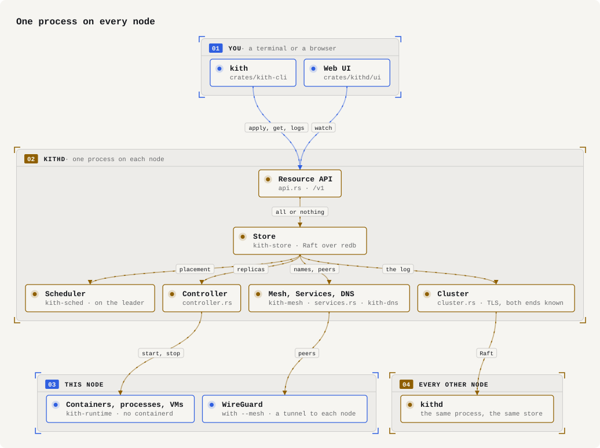

<p align="center"></p>

> **kith** *(n.)* one's close circle; the people you trust.

A tiny, immutable operating system that turns all of your machines into one
cluster, configured entirely through declarative resources. On every node one
process, `kithd`, is the API, the store, the scheduler and the container
runtime (under 13.2 MB, a budget the build is held to); `kith` is the command you
drive it with.

<picture>
  <source media="(prefers-color-scheme: dark)" srcset="docs/ui-dark.png">
  
</picture>

A page that shows it, with every number measured: <https://chasesunstrom.github.io/kith/>.
The design is in [PLAN.md](PLAN.md); what was read for security, and what kith
does not defend against, in [SECURITY.md](SECURITY.md).

## First run

On one Linux machine, as you: no root, an existing distribution (it needs
cgroup v2 and a systemd user session, which a current desktop or server has)
and a Rust toolchain. Most of the time it takes is the build.

1. Build the two programs and put them on your path.

   ```sh
   cargo build --release
   export PATH=$PWD/target/release:$PATH
   kith --version
   ```

   You should see `kith 1.0.0`.

2. Start the daemon.

   ```sh
   systemd-run --user --scope --quiet kithd &
   ```

   (Not plain `kithd &`: its containers' cgroups go beside its own, which must be your
   user's; from an ssh login it is root's, and kithd says so and starts nothing.)

   You should see `kithd: serving …/kithd.sock` (a socket under `/run/user/`
   that only you can open), and after it where the state is kept.

3. Apply the smallest example: one container that says hello every five
   seconds ([examples/hello.yaml](examples/hello.yaml), 14 lines).

   ```sh
   kith apply -f examples/hello.yaml
   ```

   You should see `Workload/default/hello created (revision 1)`.

4. Look at what there is. The first time its image is pulled, which takes a
   few seconds; ask again until it is ready.

   ```sh
   kith get
   ```

   You should see `hello  1         1/1 ready`.

5. Read what it says.

   ```sh
   kith logs workload/hello
   ```

   You should see `hello from w_default_hello_0_main`, a line for every five
   seconds it has run.

6. Open the web UI: the picture above, with your one Workload in it.

   ```sh
   kith ui
   ```

   You should see `http://127.0.0.1:…/ui/`. Open that address in a browser on
   the same machine; ctrl-c ends it.

7. Take the Workload away again.

   ```sh
   kith delete workload/hello
   ```

   You should see `Workload/default/hello deleted`.

That is all of it on one machine. `kill %1` stops the daemon; what you applied
is still there when it starts again.

## What do you want to do?

| To | Read |
|---|---|
| Run containers, plain processes and jobs, and change them safely | [What kithd does today](docs/guide/workloads.md#what-kithd-does-today) |
| Make several machines one cluster | [More than one node](docs/guide/cluster.md#more-than-one-node) |
| Give what runs a name, inside and outside | [DNS](docs/guide/cluster.md#dns); a host of its own with a certificate: [More than one node](docs/guide/cluster.md#more-than-one-node) |
| Say a thing once: names, functions and imports instead of YAML repeated | [kith's own language](docs/guide/api.md#kiths-own-language) |
| Install an app with its settings, and upgrade it (a Job annotated `kith.dev/hook` runs before or after: `pre-install`, `post-install`, `pre-upgrade`, `post-upgrade`; delete hooks are not built) | [Packages](docs/guide/packages.md#packages) |
| Keep a cluster in step with a git repository | [Sources (GitOps)](docs/guide/packages.md#sources-gitops) |
| Use kubectl, Helm and the manifests you have, unchanged | [kubectl and Helm, as they are](docs/guide/kubernetes.md#kubectl-and-helm-as-they-are) |
| Turn manifests or a chart into kith's own files | [Importing from Kubernetes and Helm](docs/guide/kubernetes.md#importing-from-kubernetes-and-helm) |
| Add a kind of your own, with its controller | [Kinds of your own](docs/guide/api.md#kinds-of-your-own) |
| Let other people and programs in, each with their own rights | [Who may do what](docs/guide/access.md#who-may-do-what) |
| Run `kith` on a laptop, over TLS to a node | [Use kith from a laptop](docs/guide/access.md#use-kith-from-a-laptop) |
| Name a remote cluster once (`kith context add`) and reach it with `--context` | [Contexts](docs/guide/access.md#contexts-a-name-for-a-cluster) |
| Hand out GPUs and seats, run virtual machines | [Hardware](docs/guide/hardware.md#hardware) |
| Run a Flatpak app in a seat's window | [Running a Flatpak app in a session](docs/guide/hardware.md#running-a-flatpak-app-in-a-session) |
| Keep data: volumes, shares, replicas, backups | [Storage](docs/guide/storage.md#storage) |
| Copy files into a volume or out of it, or move a guest's data in | [Files in and out of a volume](docs/guide/storage.md#files-in-and-out-of-a-volume) |
| See it and change it in a browser | [Web UI](docs/guide/ui.md#web-ui) |
| Make a machine nothing but a node, and keep it updated | [kith OS](docs/guide/os.md#kith-os-kithd-as-the-machines-first-process) |
| Know what it costs beside Kubernetes | [Beside k3s](#beside-k3s), and [how it was measured](docs/guide/numbers.md#how-the-numbers-beside-k3s-were-taken) |
| Find your way in the code and test it | [Layout](docs/guide/development.md#layout), [Development](docs/guide/development.md#development) |

## Coming from docker compose

```sh
kith import compose docker-compose.yml --node n1 -n media > stack.yaml   # review it, then: kith apply -f stack.yaml
```

This is a translation, once; kith does not run compose. Each service becomes a Workload
(a pod of its own, as in compose), its `ports` a Service of the compose name, and each host
directory or named volume a Volume on the node `--node` names. Exit status 1 means something
is in the report on stderr: the resources are still printed.

kith refuses by path and name what it cannot carry: `cap_add` (kith only drops capabilities),
`sysctls`, `devices` (a DeviceClaim hands hardware in), `privileged`, `env_file` (write the
variables under `environment`), `build`, `security_opt` and `tmpfs`; the guide lists the rest.
The whole table is [From a docker-compose file](docs/guide/kubernetes.md#from-a-docker-compose-file).

## How it works

<picture>
  <source media="(prefers-color-scheme: dark)" srcset="docs/assets/diagrams/architecture-dark.svg">
  
</picture>

You say what should exist, in files. `kithd` makes each node match:

- `kith apply` sends the files to a node, which takes all of them or none.
- On the node that leads the store, the scheduler says which node runs each replica.
- Every node's controller starts and stops what is its own, with no container daemon in between.
- With more than one node, the store is copied to the others by Raft.
- Started with `--mesh`, the nodes also set up WireGuard tunnels between themselves, so
  what runs on one node reaches what runs on another.

## Status

Every phase of the plan has been worked through, and the tree is at version
1.0.0: `kith.dev/v1` [is stable](docs/guide/api.md#kithdevv1-is-stable). No release has been
tagged. Each section below says what works and, under "Not yet", what does not
(some of it named by the plan); what was read for security,
and what kith does not defend against, is in [SECURITY.md](SECURITY.md).

A node's encrypted state can also be opened by its TPM, by its TPM plus a PIN typed at
its console, by the cluster, by a recovery key or by a passphrase. A virtual TPM trusts its
host: whoever runs the machine under a VM reads its memory and the virtual TPM's state, so
no way keeps the key from them. Every test of the TPM and the PIN ran on a software TPM
(swtpm); none ran on a real TPM, so the PIN is refused unless the owner passes
`--untried-tpm`. Not yet: a FIDO2 security key as a way in, and a second encrypted disk,
are designed ([docs/adr-fido2.md](docs/adr-fido2.md), [docs/adr-second-disk.md](docs/adr-second-disk.md))
and not built. What each way leaves open is in [SECURITY.md](SECURITY.md) and
[docs/adr-unlock.md](docs/adr-unlock.md#what-each-way-leaves-open).

`kithd` runs as a service on an existing Linux distro (agent mode), or as the
first process of [kith OS](docs/guide/os.md#kith-os-kithd-as-the-machines-first-process), where
what it started keeps running while kithd itself is restarted (process 1 is the same file
keeping kithd: [keeper.rs](crates/kithd/src/keeper.rs), 120 lines). It runs on
one machine, or on several [joined into a cluster](docs/guide/cluster.md#more-than-one-node), owns
the store, and keeps the containers, processes and machines on its node matching
the resources you apply.

The [first run](#first-run) is one node in agent mode; beyond it, everything goes
through the same few commands:

```sh
kith get workload/hello -o yaml  # status: each container's state, restarts and last exit code
kith get -w workload             # the table, then each row as it changes (a long-poll on GET /v1/watch)
kith logs workload/hello -f      # its output, as it arrives
kith lint -f examples/           # validate files; needs no daemon
kith diff -f examples/           # what apply would change; exits 1 if anything
kith apply -f examples/          # all or nothing
kith history workload/hello
kith rollback workload/hello --to 1
kith schema                      # the 38 built-in kinds; `kith schema workload` prints its JSON Schema
```

Mistakes are reported with the file, line and column:

```
web.yaml:7:13: invalid type: string "yes", expected u32
  |   replicas: yes
  |             ^
```

## Beside k3s

`sh ci/compare.sh` starts the same three machines twice (QEMU with KVM, 2 CPUs and
2048 MB each, on a network of their own):

- as three kith OS nodes;
- as Alpine 3.24 with k3s v1.37.2 as it comes: a server and two agents, with the DNS,
  ingress, load balancer, metrics and storage k3s starts by itself.

It measures both from outside, the same way, runs the same workloads on both, and
writes the tables down ([ci/compare.txt](ci/compare.txt)):

<picture>
  <source media="(prefers-color-scheme: dark)" srcset="docs/assets/diagrams/beside-k3s-dark.svg">
  
</picture>

| | kith | k3s |
| --- | --- | --- |
| Memory in use on an idle node: the first node / the server | 66 MB (66 to 67, 3 runs) | 1030 MB (967 to 1035, 3 runs) |
| Memory in use on an idle node: another node / an agent | 65 MB (65 to 66, 3 runs) | 474 MB (472 to 479, 3 runs) |
| From apply to a ready container, its image on the node | 0.03 s (0.03 to 0.04, 3 runs) | 0.50 s (0.49 to 0.61, 3 runs) |
| A node lost: until its replica is ready on another, as each system comes | 300 s (300 to 305, 3 runs) | 350 s (344 to 364, 3 runs) |
| The same, each told to wait about 60 s | 60 s | 57 s |
| From switching a machine on to a node that is ready | 2.6 s (2.6 to 3.8, 3 runs) | 30.8 s (29.7 to 34.2, 3 runs) |
| CPU in use on an idle node: the first node / the server | 0.8 % of one CPU (0.7 to 0.9, 3 runs) | 11.2 % of one CPU (10.4 to 12.2, 3 runs) |
| CPU in use on an idle node: another node / an agent | 0.8 % of one CPU (0.7 to 0.9, 3 runs) | 5.1 % of one CPU (4.8 to 5.8, 3 runs) |
| On the first node's disk at the end | 248 MB (248 to 248, 3 runs) | 1261 MB (1261 to 1261, 3 runs) |

The same workloads, sent to each system's API in the same way (ci/compare_workloads.py):

| | kith | k3s |
| --- | --- | --- |
| One workload of 30 replicas: until all are ready | 0.17 s (0.16 to 0.22, 3 runs) | 2.72 s (2.63 to 3.57, 3 runs) |
| Memory in use that each of those replicas adds | 0.4 MB (0.4 to 0.5, 3 runs) | 11.9 MB (11.5 to 13.4, 3 runs) |
| 20 workloads at once: until all are ready | 0.16 s (0.14 to 0.17, 3 runs) | 4.29 s (4.25 to 4.32, 3 runs) |
| A change to a workload of 6 replicas: until all 6 run it | 0.14 s (0.11 to 0.17, 3 runs) | 1.33 s (1.28 to 1.47, 3 runs) |
| A container that exits: until it runs again | 0.01 s (0.01 to 0.02, 3 runs) | 0.69 s (0.41 to 0.87, 3 runs) |
| A Job that does nothing: until it has succeeded | 0.07 s (0.07 to 0.07, 3 runs) | 2.92 s (2.88 to 2.97, 3 runs) |
| Requests a second through a Service to 3 web servers, a connection each | 7367 (7236 to 7420, 3 runs) | 6988 (6698 to 7377, 3 runs) |
| Of those requests, half took under | 2 ms (2 to 2, 3 runs) | 3 ms (2 to 3, 3 runs) |
| and 99 in 100 under | 8 ms (7 to 8, 3 runs) | 9 ms (9 to 10, 3 runs) |
| Requests a second over connections that are kept | 26004 (25889 to 26682, 3 runs) | 24081 (23688 to 25074, 3 runs) |

Alpine alone, before k3s is started on it, has 233 MB (222 to 233, 3 runs) in use; kith OS has no such moment (kithd is its first process).
A kith OS machine answers on its API 2.5 s (2.5 to 3.7, 3 runs) after it is switched on (firmware included).

Of k3s's time to a ready node, 24.7 s (23.6 to 28.2, 3 runs) is Alpine starting; the rest is k3s, started by hand the moment Alpine takes a login.

One shape of machine, three nodes, a few runs, on a host doing other work at the time.
Where the two differ in what they do, the numbers are not of the same thing:

- a kith container shares its node's network;
- a kith Service is passed on by kithd and encrypted between nodes;
- k3s is the whole Kubernetes API.

How each row is measured, and what the tables do not say: [How the numbers beside k3s were taken](docs/guide/numbers.md#how-the-numbers-beside-k3s-were-taken).

## The compose stack beside docker

`KITH_E2E=1 sh ci/vm.sh --test compose` also brings the same eight-service media file
([ci/compose/media.yml](ci/compose/media.yml)) up under `docker compose up -d` on an Alpine
machine, and prints both times. One run: kith 2.788 s from `kith apply` to every Workload ready
(a 512 MB node, ready includes the HTTP probes), docker 0.915 s from `docker compose up -d` to
all eight containers running (docker 29.9.3, median of three, a 2048 MB machine, no health wait).

kith is slower, by 1.873 s (3.0 times), because the two stop their clocks at different
moments: kith's at the probes passing, docker's at the containers running; because each
service is a pod of its own, with its volumes made on the node, where docker starts a
container; and because the test polls kith's API every 0.2 s. The run does not split
that 1.873 s among the three. It is one run of kith on a host with other work going on:
read it as the order of magnitude, not a ratio. How it was taken:
[the compose stack beside docker](docs/guide/numbers.md#the-compose-stack-beside-docker).

## Under load

`sh ci/stress.sh` puts containers on the same three machines (or one of them, `--nodes 1`), a size at a time, first as kith OS and then, with `--system k3s`, as k3s. It stops at the first size that fails. Each machine has 2048 MB and 2 CPUs, as above. The table is [ci/stress.txt](ci/stress.txt), row for row; a test holds it to that file.

| containers | nodes | system | max pods a node | ready (s) | memory each (MB) | Services (s) | answers | store | back (s) |
| --- | --- | --- | --- | --- | --- | --- | --- | --- | --- |
| 100 | 3 | kith | - | 0.55 | 0.50 | 4.08 | yes | ok | 0.01 |
| 100 | 1 | kith | - | limit | - | - | - | - | - |
| 100 | 3 | kith | - | 1.07 | 0.57 | 5.13 | yes | ok | 0.03 |
| 300 | 3 | kith | - | 2.51 | 0.57 | 5.13 | yes | ok | 0.23 |
| 1000 | 3 | kith | - | 7.88 | 0.61 | 8.57 | yes | ok | 0.04 |
| 100 | 3 | k3s | 110 | 7.10 | 12.76 | 6.14 | yes | - | - |
| 1000 | 3 | k3s | 444 | limit | - | - | - | - | - |
| 100 | 1 | k3s | 110 | limit | - | - | - | - | - |
| 300 | 3 | k3s | 210 | limit | - | - | - | - | - |

- `limit` in the ready column: that size did not finish. Its row in ci/stress.txt says where it stopped and what the nodes said of themselves; the cells after it are `-`.
- A k3s row's last column is the most pods a node was let run: 110 (k3s's default) up to 100 containers, and above that the containers' share per node plus 110, with kubelet's max-pods raised and a /22 pod range on the server.
- k3s has no restart in this run, so its `store` and `back (s)` are `-`.
- kith stopped at 100 containers on one node, at Services readiness: 0 of 10 Services had their backends after 121 s.
- k3s stopped at 100 on one node: k1 ran 107 pods on 2 vCPUs, the kernel logged soft lockups (a CPU stuck for 22 s and for 51 s), and k1's memory reader gave no reading. The row shows the node's own counts instead (179 MB free, 104 of 107 pods running), and no node had an OOM kill. The cause is inferred from those lines and counts, not from a kubelet trace.
- k3s stopped at 300 on three nodes: the API handshake timed out after 198 s and no node answered, with nothing logged on any of them. The cause is not established; the row does not say whether the API or the hosts were saturated.
- k3s at 1000 on three nodes: the API stopped answering after 171 s.
- Two earlier k3s rows at 100 on one node and 300 on three had no cause. The adapter raised an uncaught error reading the memory reader and the row kept only the console lines. That was a bug in ci/stress_workloads.py, fixed and tested; the rows above are the reruns.
