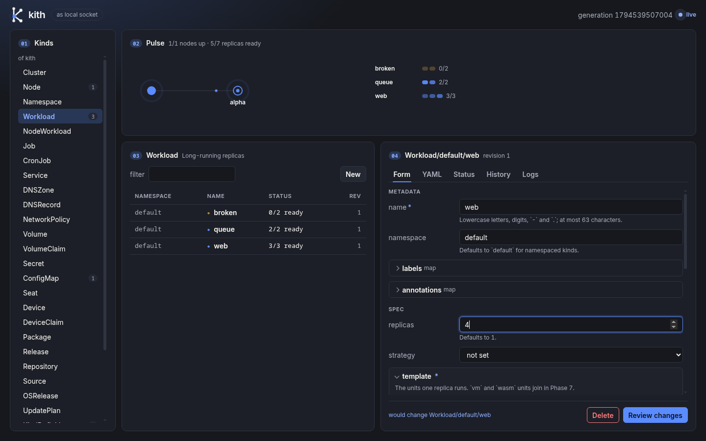

<p align="center"></p>

> **kith** *(n.)* one's close circle; the people you trust.

A tiny, immutable operating system that turns all of your machines into one
cluster, configured entirely through declarative resources. The design is in
[PLAN.md](PLAN.md).

## Status: one node, in agent mode

`kithd` runs as a service on an existing Linux distro, owns the store, and keeps
the containers and processes on that machine matching the `Workload`s and `Job`s
you apply. Clustering,
networking and the OS image come next (Phase 2 onwards in the plan).

```sh
cargo build --release
export PATH=$PWD/target/release:$PATH

kithd &                          # as you, no root: needs cgroup v2 and a systemd user session
kith apply -f examples/hello.yaml
kith get                         # Workload  default  hello  1  1/1 ready
kith get workload/hello -o yaml  # status: each container's state, restarts and last exit code
kith get -w workload             # the table, then each row as it changes (a long-poll on GET /v1/watch)
kith logs workload/hello -f      # its output, as it arrives
kith delete workload/hello       # stops its containers
```

Everything goes through the same few commands:

```sh
kith lint -f examples/           # validate files; needs no daemon
kith diff -f examples/           # what apply would change; exits 1 if anything
kith apply -f examples/          # all or nothing
kith history workload/hello
kith rollback workload/hello --to 1
kith schema                      # the 26 built-in kinds; `kith schema workload` prints its JSON Schema
```

Mistakes are reported with the file, line and column:

```
web.yaml:7:13: invalid type: string "yes", expected u32
  |   replicas: yes
  |             ^
```

## What kithd does today

- Serves the resource API as HTTP/JSON on a unix socket only you can open
  (`$XDG_RUNTIME_DIR/kith/kithd.sock`; `--socket` or `KITH_SOCKET` to move it).
  `kith` gives up on a kithd that has not answered for 30 s (`--timeout` or
  `KITH_TIMEOUT`, in seconds); a change that timed out may still have been applied.
- One kithd per state directory: a second one is refused instead of left waiting.
- Keeps resources and their revision history under `~/.local/state/kith/raft`
  (`--state` or `KITH_STATE`): a log of changes that is synced to disk before a
  change is answered, and a snapshot of the store now and then. It is the same
  replicated store a cluster uses, with this node as its only member. A
  `store.json` left there by an older kithd is brought in on the first start.
  `kith --store FILE` reads or edits a store kept in a plain file, with no
  daemon: for trying things out, not for looking into a kithd's state.
- Runs each `Workload` container in its own cgroup with youki's `libcontainer`
  linked in: no containerd, no shim, no root. Images are pulled into a
  content-addressed store; one pulled before starts without asking the registry
  (about 25 ms from `kith apply` to first output here), so `pullPolicy: always` is
  how you follow a tag that moves. Memory and CPU limits, `command`/`args`, and `env`
  from values, `ConfigMap`s and `Secret`s are honoured; containers that exit are
  restarted according to `restartPolicy`, with a backoff of up to a minute.
- Runs `exec` units next to containers: a plain process of the host (its files,
  its network, your user) in its own cgroup with the same limits and restart
  policy, for host-level tools. Whatever it forks is stopped with it.
- Runs each `Job` to completion: `completions` runs of its template,
  `parallelism` at a time (1 unless you say). A run fails as soon as one of its
  units exits non-zero or cannot start, and is tried again after a backoff;
  `retries` failed runs are forgiven (3 unless you say), one more fails the Job,
  and so does taking longer than `timeoutSeconds`. `kith get job` shows
  `running`, `succeeded` or `failed: <why>`. A finished Job runs again only when
  you change it; one that kithd was restarted under starts over.
- Keeps each unit's output: `kith logs KIND/NAME` prints it, with `--unit`,
  `--replica` (or the run of a Job), `--stderr`, `--tail LINES` and `-f` to
  follow until the unit is done. A log file that passes 10 MiB (`kithd
  --log-cap BYTES`) is moved aside, one old copy is kept (`kith logs
  --previous`), and deleting the Workload or Job deletes its logs.
- Probes containers: `readiness` decides whether a replica counts as ready, and
  a `liveness` probe that fails `failureThreshold` times in a row (3 unless you
  say) gets the container restarted, once it has passed for the first time
  (there is no start deadline yet). `tcp` and `http` probes are made against
  `localhost`, every `intervalSeconds` (10) and once a second until the first
  success.
- Updates a changed Workload one replica at a time: the next one is replaced
  only once the others are ready, so an update that does not come up stops at
  its first replica and the status says where. `strategy: recreate` replaces
  everything at once. A container or exec unit is replaced the same way when a
  `ConfigMap` or `Secret` value in its `env` changes.
- On SIGTERM it stops everything it started.

Not yet: volumes, ports and `exec` probes are accepted but do nothing
(the status says so for volumes and `exec` probes), a replica is stopped before
its replacement starts (so `replicas: 1` is down for a moment during an update;
`blueGreen` is treated as rolling), containers share the host's
network and a read-only image (tmpfs on `/tmp` and `/run`), pulls are anonymous, layers
must be gzip or plain tar, the image's `User` is ignored (containers run as
root inside their user namespace), and there is no seccomp filter. The log cap
is checked every 10 s, so a file can pass it by what its unit writes in that
time, and output written in the instant a file is moved aside is lost. Kinds other than
`Workload`, `NodeWorkload`, `Job`, `ConfigMap` and `Secret` are stored and validated but nothing acts
on them. Running as root is untested.

[`dist/kithd.service`](dist/kithd.service) is a systemd user unit for it; it has
not been run under systemd yet.

## More than one node (in progress)

Phase 2 of the plan is being built. What works today:

```sh
kithd --listen 192.168.1.10:7443 --name alpha      # first start: makes the cluster's CA
kith node token                                    # on alpha: good once, for an hour
kithd --join 192.168.1.10:7443 --token TOKEN --name beta    # on the other machine
kith get node                                      # on either: alpha and beta, `ready at` their addresses
kith node status                                   # who leads the store, who votes
```

- Every node keeps its own copy of the store (Raft, with the log on disk in
  `<state>/raft`). A change made through any node goes to the leader, is
  written to disk by more than half of the voting nodes, and only then
  answered. What a node reads is its own copy, which can be a moment behind.
- From three nodes on, three of them vote, and the cluster goes on when one of
  those is lost: the other two pick a new leader within a few seconds. With
  two nodes (also after one of three is deleted) only one votes, because two
  voters would stop when either one did; losing it stops changes until it is
  back. A node starts to vote only once it has received the store.
- `kith delete node/NAME` takes a node out of the store's members.
- Every node tells every other one, every two seconds, which nodes it has
  heard from (none of this goes through the store). A node nobody has heard
  from for ten seconds shows as `unreachable` in `kith get node`, and as
  `ready` again when it is back. A voter that is unreachable for a minute
  gives its vote to a node that is there, if the cluster has one to spare.

- The node that leads the store says which node runs each replica of a
  Workload: one with room for what it asks for (`resources`), that matches its
  `placement`, is not cordoned or tainted, and spread over the nodes. `kith
  get workload/NAME -o yaml` shows where each one is (`nodes`), or why one
  has no home (`unschedulable`); `kith logs` reads a replica's output from
  whichever node has it. A Job is run by one node. A node is given nothing
  new until the leader has heard from it (a few seconds after it joins).
- A `NodeWorkload` runs one copy on every node whose labels match its
  `selector` (empty: every node), except cordoned and `NoExecute`-tainted
  nodes and ones lost past `--lost-after`. Label a node by editing it:
  `kith get node/NAME -o yaml`, add `metadata.labels`, `kith apply`. A node
  that starts to match gets a copy, one that stops loses it; `nodes` in
  `kith get nodeworkload/NAME -o yaml` says which copy (number) each node
  runs, `kith get` shows ready over the number of nodes, and `kith logs
  nodeworkload/NAME --replica N` reads a copy's output. On one node (no
  cluster) it runs one copy if the selector is empty, none otherwise.
- A replica stays on its node. When the node has been unreachable for five
  minutes (`--lost-after SECONDS`), its replicas are started on other nodes,
  and stay there when it comes back; a Job it was running starts over.
  A node that restarts runs nothing until it has caught up with the store
  (it may have lost replicas while it was away), so not while the cluster has
  no leader.

- Nodes talk over TLS and both ends show a certificate from the cluster's CA:
  that proves membership, not which member (every node trusts every other).
  Without one, a caller can read the CA certificate and present a join token,
  nothing else, and is cut off after 15 s.
- The token carries the CA's fingerprint: a joining node checks who it is
  talking to before it sends the token's secret.
- A node keeps its identity in `<state>/pki`; after the first start it needs
  neither `--join` nor `--token`.
- With `--mesh` (optionally `--mesh 51820`, the UDP port) a node joins the
  cluster's WireGuard mesh: kithd makes the interface `kith0`
  (`--mesh-interface NAME`) itself, with no `wg` or `ip`, which takes the
  kernel's WireGuard and CAP_NET_ADMIN (without them kithd says so and runs
  without a mesh). Every node gets a stable IPv6 address worked out from the
  cluster's CA and its own name, `kith get node/NAME -o yaml` shows it and
  the node's public key (`mesh`), and `kith node status` lists the peers and
  when each last shook hands. The private key stays in `<state>/pki`.
  Peers are reached at the address the cluster knows them by. One that has
  not answered for three minutes is reached through a node with the `edge`
  role instead, and directly again when it answers; the edge node's machine
  has to forward (`net.ipv6.conf.all.forwarding=1`, kithd warns if it does
  not and leaves the setting alone), and it sees what it passes on. kithd
  takes over a WireGuard interface of that name that is already there (its
  key and peers are replaced; one that is not WireGuard is refused) and
  removes the interface when it stops. `sh ci/mesh_rtt.sh` measures what the
  mesh adds to a round trip between two namespaces on a veth (not a LAN): +0.08 to
  +0.15 ms over the veth's 0.03 ms in five runs here, against the plan's 0.3 ms.
- On the mesh a `Service` has an address of its own, the same on every node
  (`kith get service/NAME -o yaml` shows it and the number of ready replicas
  behind it), and the name `<service>.<namespace>.kith` where kithd answers
  DNS. A TCP connection from a node to that address and one of the Service's
  ports goes to a ready replica of the Workloads its selector matches, each
  in turn, on whichever node it runs: kithd passes the bytes on, over the
  mesh if the replica is elsewhere, to the replica's port on its node's
  `127.0.0.1` (or `::1`). A kithd that restarts drops the connections through
  it. Only TCP; a `targetPort` by name is a container port of that name.
- A `NetworkPolicy` says who may connect to the Workloads it selects through
  a Service: the first ingress rule that fits decides, and when a policy
  selects a Workload and no rule fits, the connection is refused. A peer is
  told by `node` (the node the connection comes from) or `cidr`. Peers by
  `namespace` or `selector` cannot be told apart yet (an allow rule for them
  lets nobody in, a deny rule keeps everybody out) and egress rules are not
  enforced; the policy's status says `partial` and why, `enforced` otherwise.
  A policy does not stop a connection that goes to a node's own address
  instead of the Service's.
- With `--ingress` (and `--mesh`; meant for nodes with a public address) a
  node answers HTTPS on port 443 for every Service with `expose`, by the host
  the client asks for, and passes the connection on to the Service (its first
  TCP port); port 80 sends browsers to HTTPS. Binding the two ports takes
  CAP_NET_BIND_SERVICE. A host's certificate is the Secret `tls-<host>` next
  to its Service (`tls.crt` and `tls.key`, PEM): apply your own, or start the
  node with `--acme` and kithd gets one from Let's Encrypt (`--acme URL` for
  another ACME directory; giving the flag agrees to that authority's terms)
  and another before it runs out. The host's DNS has to point at the ingress
  nodes first: the authority checks by asking port 80 there, and any node
  with `--ingress` can answer. `kith get service/NAME -o yaml` shows how it
  went (`tls`: its `secret` names the Secret whose certificate serves the
  host, one applied by hand included); after a failure kithd tries again an
  hour later, not sooner.
  TLS ends at the ingress and the bytes go on as they are: no header is added,
  and to a NetworkPolicy the connection comes from the ingress node. With
  `expose.proxyProtocol: true` the backend is sent a PROXY protocol v1 line
  (`PROXY TCP4 <client> <ingress> <client port> <ingress port>`) with the
  client's address before the client's bytes; it is off unless asked for,
  because a backend that does not expect the line will break on it. Only the
  ingress sends it: a client inside the mesh that calls the Service gets
  none, so the backend has to take both. Certificate keys and the ACME account key
  (`Secret/kith-system/acme-account`) are in the store like other Secrets.
  `expose.host` has to be a domain name (applying anything else is refused).
  Two Services with one host: the first by key has it, and the other's
  status says `expose: refused` and why. Each port takes 1024 connections at
  a time (more are hung up on); one with no byte either way for 5 minutes on
  443 is closed, and one on 80 after 30 seconds whatever it does.

Not yet: the nodes still talk to each other at their plain addresses, not
over the mesh, workloads have no addresses on it, and two nodes that
are both behind NAT only reach each other through an edge node.
Replicas of one Workload on different nodes are all replaced at once
when it changes (on one node it is one at a time; a `NodeWorkload` is always
replaced all at once), and replicas on a node that is unreachable still count as ready until they are
moved. A change whose answer was lost with the leader may or may not have
happened; `kith get` tells. Joining needs an empty `--state`. A joined node
that moves to another address has to be deleted and joined again.
Only the first node can admit others, tokens do not survive its restart (and
`--token` shows in the process list until then: `KITH_TOKEN` does not), a join
that dies halfway needs `kith delete node/NAME` and a new token,
certificates last ten years and cannot be renewed or revoked, and `kith` itself
only talks to the kithd on its own machine.

## DNS

```sh
kithd --dns 192.168.1.10:53          # UDP and TCP; port 53 needs root or CAP_NET_BIND_SERVICE
kith apply -f examples/dns.yaml      # a DNSZone and two DNSRecords
dig @192.168.1.10 nas.home.example   # 192.168.1.20
kith get dnsrecord                   # each one says `served`, or why not
```

- `<node>.node.kith` is the address each node of the cluster is reached at,
  `<node>.mesh.kith` its address on the mesh (if it is on it).
  Names under `kith` are the cluster's own: a zone cannot take them.
- A `DNSZone` is a domain kithd answers itself; a `DNSRecord` is a name in one:
  A, AAAA, CNAME, TXT, SRV, NS or PTR, `*.apps` for a wildcard, `@` for the
  zone itself. Names in values are full names (`nas.home.example`).
- Split horizon: a zone with `clients: [192.168.0.0/16]` is what those clients
  get, in place of a zone for everyone with the same domain. A client inside
  two different `clients` lists gets only one of them, the list with the
  longest matching prefix (`10.1.2.0/24` beats `10.0.0.0/8`; equal prefixes
  go to the list that sorts first): give zones that belong together the same
  list.
- Every other name is passed to the resolvers in `/etc/resolv.conf`
  (`--dns-upstream 1.1.1.1,9.9.9.9` to say which), for clients on private
  networks only, so a kithd reachable from the internet is not an open
  resolver. Point your router's DHCP at a node and the whole house uses it.
  A CNAME in a zone to a name outside it is answered with the target's
  addresses from those resolvers too, so stub resolvers get one reply to use
  (the CNAME alone when they do not answer).
- In a cluster every node started with `--dns` answers the same names.

Not yet: `<service>.<namespace>.kith` (with the load balancer), DNSSEC, zone
transfers, and caching of upstream answers.

## Packages (in progress)

A package is a directory of resource templates with default values
([`packages/web`](packages/web) is one):

```text
package.yaml          name, version, description, kithVersion, dependencies
values.yaml           the default values
values.schema.json    what values may be (optional)
templates/*.yaml      resources, as templates; files named _something are only included
NOTES                 what to tell whoever installed it (optional; a template too)
```

```sh
kith package lint packages/web
kith package render packages/web --name shop -n store --set replicas=3 -f mine.yaml
kith package render packages/web --name shop | kith apply -f -
```

- Templates are Jinja ([minijinja](https://docs.rs/minijinja)). They see
  `values` (the defaults, with each `-f` file and then each `--set` on top,
  merged key by key), `release.name`, `release.namespace`, `package.name`,
  `package.version`, `name` (a name for the release's resources:
  `shop-web`) and `labels`. `{{ value | toYaml | indent(4) }}` writes a value
  as YAML, `{{ value | tojson }}` quotes one that could be anything, and
  `required(value, "why")` stops with `why` when there is none. Using a value
  that is not there is an error, and so is a template that never ends or
  writes more than 1 MB. A template reads nothing but its package (links in
  the package's directory are not followed), and `namespace()` is not there.
- What comes out is checked like any resource (an error shows the rendered
  text's line), put in the release's namespace unless it names one, and
  labelled `kith.dev/release` and `kith.dev/package`.
- Values are checked against `values.schema.json`, of which kith knows
  `type`, `properties`, `required`, `additionalProperties`, `items`, `enum`
  and the `minimum`/`maximum` family; `lint` says so about any other keyword.

### Releases

A cluster installs a package itself: push the package, apply a `Release`.

```sh
kith package push packages/web      # the package, as Package/web-0.1.0 in the store
kith apply -f release.yaml
kith get release/shop -n store -o yaml   # status: state, version, resources, notes
```

```yaml
apiVersion: kith.dev/v1
kind: Release
metadata: { name: shop, namespace: store }
spec:
  package: { name: web, version: 0.1.0 }   # no version: the newest pushed
  values: { replicas: 3 }
```

- The node that leads the store renders the package and applies what comes
  out; a change to the Release, to the package or to shared values is rendered
  and applied again, and what is no longer rendered is deleted. Deleting the
  Release deletes what it installed. `kith rollback release/shop --to N`
  goes back to an earlier Release, and so to what that installed.
- Values, later over earlier: the package's defaults, the key `values` (YAML)
  of the ConfigMap `kith-system/kith-values`, the same in the Release's
  namespace, the Release's `spec.values`.
- What a release installed is annotated `kith.dev/owned-by` with the Release's
  key and listed in the Release's status; only what is both is deleted when
  it is no longer rendered, and everything so annotated goes when the Release
  does (so `kith apply` refuses a resource annotated as a Release's when
  there is no such Release). A release does not take over a resource that is
  there already and not its own, stays in its own namespace, and makes
  nothing that is in no namespace (a Node, a Package), no Release or Source,
  and no `kith-values` ConfigMap; any of these (or a template that fails) is
  `state: error` with the reason in `message`, and what was installed before
  stays as it was.
- `version` is one version (`1.2.0`) or a range (`^1.2`, `>=1, <3`); none is
  any version that is not a pre-release. A Release goes on the newest
  package that fits and stays on it; with `autoUpgrade: true` it follows
  newer ones as they come. Pushing a version again replaces it.

### Repositories

Packages travel as OCI artifacts in any registry, signed:

```sh
kith package keygen signing.key        # the secret into the file; prints the public key
kith package push packages/web --to oci://registry.example/packages --key signing.key
kith package pull oci://registry.example/packages web 0.1.0 --public-key 3f9c…
```

```yaml
apiVersion: kith.dev/v1
kind: Repository
metadata: { name: ours }
spec: { url: oci://registry.example/packages, publicKey: 3f9c… }
---
apiVersion: kith.dev/v1
kind: Release
metadata: { name: shop }
spec:
  package: { repo: ours, name: web, version: ^0.1 }
  autoUpgrade: true
```

- The package `web` is the repository `packages/web` there, each version a
  tag. The artifact is one blob (the package's files) and a signature
  (Ed25519, over the package's name, version and the blob's SHA-256) as the
  annotation `dev.kith.signature`.
- For a Release that names a Repository, the node that leads the store asks
  the registry for the versions, fetches the newest that fits, checks it
  against the Repository's `publicKey` and stores it as a Package (annotated
  `kith.dev/repository`); the Release installs only Packages from its
  Repository. A package that is unsigned or signed with another key is
  refused, and the Repository's status says so (`state: error`, `message`).
  A newer version that does not check out is passed over for the newest
  that does (the status says which). A Repository without a `publicKey`
  takes packages as they come. Change a Repository's `url` or `publicKey`
  and what was fetched before is no longer taken for its: it is fetched and
  checked again.
- A Package keeps its last 3 revisions (other kinds keep 100), because it
  carries its files; push a new version rather than rolling far back.
- A version is fetched once: pushing it to the registry again changes
  nothing here. A registry can also keep quiet about newer versions; the
  signature says a package is the publisher's, not that it is the newest.
- Registries are asked when a Release wants something new and every
  `--repository-poll` seconds (300) for Releases with `autoUpgrade`.
- `kith` reaches a registry through kithd (push and pull need a running
  kithd). No registry logins yet; plain HTTP only to a registry on the same
  machine.

Not yet: `dependencies` are read and nothing more; no hooks, no looking up
what is in the cluster from a template, no registry credentials.

## Sources (GitOps)

A `Source` keeps what is in a git repository (or an OCI artifact) applied:

```yaml
apiVersion: kith.dev/v1
kind: Source
metadata: { name: cluster, namespace: kith-system }
spec:
  git: { url: https://example.org/ops/cluster.git, rev: main }
  path: clusters/home        # the YAML and JSON files under it
  intervalSeconds: 60
  prune: true                # delete what the source no longer has
  approval: manual           # hold each new revision until approved [auto]
```

```sh
kith get source/cluster -n kith-system -o yaml   # status: state, revision, pending, drift
kith source approve cluster -n kith-system       # apply the revision that waits
kith source push conf --to oci://registry.example/sources/conf:v1   # for `spec.oci`
```

- The node that leads the store fetches the source every `intervalSeconds`
  (5 at least) and applies its resources, marked `kith.dev/owned-by` like a
  Release's. A resource that names no namespace goes in the Source's. A
  Source applies only into its own namespace; one in `kith-system` applies
  anywhere and any kind (it is the cluster's own). It does not take over what
  is there and not its own.
- `status.state` is `synced` (at `revision`), `pending` (`pending.revision`
  waits for `kith source approve`, with what it would change) or `error`
  (with `message`; what was applied stays). When the source moves on, a
  manual Source waits again.
- What a Source applied and someone changed since is put back, and listed in
  `status.drift`: the source is what is true. Deleting a Source deletes what
  it applied.
- git is the node's `git` program (it must be installed), over `https://`
  or `ssh://` only, with no credentials but what ssh has; nothing is checked
  out, so links in a repository are skipped (`status.skipped`), and a
  source is 2000 files and 4 MB at most.
- Only a Source in `kith-system` is fetched over `ssh://` (it is the node's
  own keys that open the door) or from this node and its own networks
  (loopback, private, link-local and shared addresses, by whatever name).
- An approval is for a revision: a Source whose `path` or `prune` you change
  applies the revision already approved the new way.

Not yet: signed-commit verification, credentials for private repositories.

## Importing from Kubernetes and Helm

`kith import k8s -f manifests.yaml` (`-f -` reads stdin; `-f` may repeat; a
`List` is unwrapped) prints the kith resources the manifests translate to.
`kith import helm ./chart --name shop -n store -f values.yaml` runs your
installed `helm template` and translates what it prints (no helm: pipe
`helm template ... | kith import k8s -f -`). Review the output, then
`kith apply -f` it.

| Kubernetes | kith |
|---|---|
| Deployment, StatefulSet | Workload (a StatefulSet's `volumeClaimTemplates` become one shared VolumeClaim `<template>-<name>`) |
| DaemonSet | NodeWorkload |
| Service | Service |
| Ingress | `expose: {host, via: edge, proxyProtocol}` on the Service behind each host |
| ConfigMap, Secret | ConfigMap, Secret (`data` decoded from base64: the output holds the plain text) |
| PersistentVolumeClaim | VolumeClaim |
| Job, CronJob | Job, CronJob |

Nothing is dropped silently. Every field that is not carried over (an
`affinity`, a `securityContext`, an unknown kind, an object that would not
validate) is named on stderr by path, such as
`not translated: Deployment/web: spec.template.spec.affinity not translated`.
Status, `managedFields`, `uid`, `resourceVersion` and Helm's own labels are
ignored, not reported. Exit status: 0 everything translated, 1 something is
in the report (the output is still printed), 2 the input could not be read.
`nodeSelector` becomes a placement requirement, and a pod template's labels
are added to the workload's, since kith Services select on those.

## Kinds of your own

A `KindDefinition` makes a new kind. Resources of it are applied, listed,
watched, kept with their history and deleted like any other; what a kind
*does* is up to a controller that watches it.

```yaml
apiVersion: kith.dev/v1
kind: KindDefinition
metadata: { name: gameserver }
spec:
  group: games.example.com   # a domain of yours; with version, the apiVersion
  version: v1
  kind: GameServer
  namespaced: true           # [true]
  schema:                    # of the spec; the same subset as a package's values
    type: object
    required: [map]
    additionalProperties: false
    properties:
      map: { type: string }
      players: { type: integer, minimum: 1, maximum: 64 }
  columns:                   # what `kith get gameserver` shows
    - { name: Map, path: spec.map }
---
apiVersion: games.example.com/v1
kind: GameServer
metadata: { name: one }
spec: { map: dust, players: 8 }
```

- The store checks every write of such a resource against the schema, and
  says what is wrong by path (`spec.players: it must be at most 64`). In one
  `kith apply`, put the definition before what is of its kind.
- `kith get`, `delete`, `history`, `rollback` and `schema` take the kind's
  name in any case, like kith's own; `kith schema` lists the cluster's kinds
  after kith's.
- One definition per kind. A definition cannot be deleted, renamed to another
  kind or moved between namespaced and cluster-wide while resources of its
  kind exist. A changed schema is checked at the next write of each resource;
  what is stored stays as it is.
- A Source or a package may apply resources of a defined kind; a Source in
  `kith-system` may bring the definition along.

Not yet: several versions of a kind side by side, a schema for `status`.

### Controllers and admission, in WebAssembly

A kind can carry code: a **controller** that says what should exist because
of each resource of the kind, and an **admission** hook that is asked before
one is written. Both are WebAssembly modules that kithd runs itself, with no
container, image or credentials: a function from JSON to JSON that can reach
nothing else.

```rust
// sdk/kith-controller/examples/gameserver has all of it
use kith_controller::{Admit, Reconcile, Reconciled, Value, json};

fn reconcile(input: Reconcile) -> Result<Reconciled, String> {
    let name = input.resource["metadata"]["name"].as_str().ok_or("no name")?;
    Ok(Reconciled {
        status: json!({ "state": "ready" }),
        resources: vec![json!({
            "apiVersion": "kith.dev/v1", "kind": "ConfigMap",
            "metadata": { "name": format!("{name}-config") },
            "spec": { "data": { "map": input.resource["spec"]["map"] } },
        })],
    })
}

fn admit(input: Admit) -> Result<Option<Value>, String> {
    if input.resource["spec"]["map"] == "lava" {
        return Err("the map lava is closed".into());   // refused, with this reason
    }
    Ok(None)                                           // as it is; Some(resource) changes it
}

kith_controller::controller!(reconcile);
kith_controller::admission!(admit);
```

```sh
rustup target add wasm32-unknown-unknown
cargo build --release --target wasm32-unknown-unknown    # a cdylib depending on sdk/kith-controller
kith controller set GameServer --controller game.wasm --admission game.wasm
```

`kith controller set` puts the module in the kind's KindDefinition
(`spec.controller.wasm`, `spec.admission.wasm`, base64), so it is replicated,
kept in history and rolled back like the rest of the cluster's state.

- **The controller** runs on the node that leads the store, whenever the
  resource, the module, or something the resource owns changes. It is given
  `{resource, owned}` and answers `{status, resources}`. The resources are
  made so in the resource's namespace as its own (annotated
  `kith.dev/owned-by`), put back if someone changes or removes them, removed
  when no longer answered, and removed with their owner. It may make anything
  namespaced except a Release or a Source, including resources of other
  defined kinds, whose controllers then run in turn.
- Its `status` fields are recorded on the resource, with `resources` (what it
  owns) and `controller`: `{state: ok, observedRevision}` or `{state: error,
  message}`. A run that fails changes nothing and is tried again when
  something changes.
- **Admission** is asked about every apply of a resource of the kind through
  kithd, whoever makes it (`kith apply`, a Source, a Release, a controller),
  with `{resource, old}`. It may refuse (`refused by GameServer's admission:
  the map lava is closed`, also on `--dry-run`) or change the spec, labels
  and annotations; what it makes of the resource is then checked against the
  schema like any write. A hook that fails refuses the write.
- **Limits**, each ending that one call with the reason: a module of at most
  1 MiB, 50 million instructions' worth of fuel, 16 MiB of memory, 1 MiB of
  input and of answer. A module that imports anything does not start. Each
  call starts from a fresh instance: nothing is remembered between calls.
- Whoever may write KindDefinitions may run code in every namespace through
  them: grant that as you would grant admin.

Things to know: a rollback is asked of admission too (what it refuses does
not come back; what it would change comes back as it was); a delete is not
asked. At most four modules run at once, and a controller answers at most 64
resources. Applying
a KindDefinition's YAML again without its `controller`/`admission` removes
them (keep the YAML and the module together, or run `kith controller set`
after). `kith --store FILE`, which works on a file without kithd, runs
neither. A module sees one resource and what it owns; a controller that has
to look further is a Workload using the API.

In another language: export `memory`, `kith_alloc(len: u32) -> ptr`, and
`kith_reconcile` / `kith_admit` as `(ptr: u32, len: u32) -> u64`: JSON in at
`ptr`, and the answer's `ptr << 32 | len` out, `{"ok": …}` or `{"error":
"why"}`.

## Who may do what

On a node, whoever can open kithd's socket is the admin: `kith` there may do
everything. From anywhere else, a person or a program calls a node's TLS port
(`--listen`) as an **Identity**, with a certificate from the cluster's CA,
and may do what the **Roles** bound to it allow. Nothing, to begin with.

```sh
kith identity cert alice --out ~/alice    # on the node the cluster was started on
```

writes `alice.crt`, `alice.key` and `ca.crt`, and makes `Identity/alice` if it
is not there. Then say what she may do:

```yaml
apiVersion: kith.dev/v1
kind: Role
metadata: { name: web-editor }
spec:
  rules:
    - kinds: [Workload, Service, ConfigMap]   # or ['*']
      verbs: [get, list, watch, apply, delete]
      namespaces: [web]                        # left out: everywhere
---
apiVersion: kith.dev/v1
kind: RoleBinding
metadata: { name: alice-web }
spec:
  role: web-editor
  subjects: [alice]        # Identities by name, or `group:ops` for spec.groups
```

```sh
curl --cacert ca.crt --cert alice.crt --key alice.key \
     --resolve kith:7443:10.0.0.7 https://kith:7443/v1/resources?kind=Workload
```

(Every node's certificate is good for the name `kith`. `kith` itself only
talks to the local socket so far.)

- What is not allowed is refused with 403 and the reason. `list` and `watch`
  show what the caller may see and no more. An apply is all or nothing: one
  resource it may not apply refuses the whole body.
- `get` covers a resource, its history and its output (`/v1/logs`); `apply`
  covers rollback; pushing to or pulling from a registry through kithd takes
  `apply` on `Package` (kithd then calls whatever registry is named: grant
  it to those you would let do that).
- A rule that names namespaces says nothing of kinds that are in none (Node,
  Role, KindDefinition…): those take a rule without `namespaces`.
- The certificate stands for the Identity while the Identity's `publicKey` is
  the certificate's key. `kith identity cert` again gives a new key and ends
  the old certificate's access; `kith delete identity/alice` ends it all.
- Grant with care: `apply` on Role, RoleBinding or Identity is the power to
  grant oneself anything, and whoever may apply a Workload runs programs on
  your nodes. A Release or Source acts for the cluster, not for whoever
  applied it.

Every change made through a node, and every refusal, is one line in that
node's audit log (`audit.log` in its state directory, 4 MB and the 4 MB
before): when, who, what, and how it went. Refusals past sixty a minute are
counted rather than written. `kith audit` shows the last of it,
as does `GET /v1/audit` for an Identity with `get` on `Audit`.

```
WHEN                  WHO           DID     WHAT                            OUTCOME
2026-11-12T10:02:11Z  local socket  apply   Role/web-editor                 ok
2026-11-12T10:03:40Z  alice         apply   Workload/web/site               ok
2026-11-12T10:03:55Z  alice         delete  Node                            alice may not delete Node: no Role bound to it allows that
```

Not yet: `kith` over TLS, logging in through an identity provider (OIDC),
certificates that expire before ten years, one audit log for the cluster.

## Web UI

Every node serves a page that shows the cluster and changes it: what is
running where, a form for every kind (drawn from the kind's schema, your own
kinds included), the YAML beside it, each resource's status, history with
rollback, and output. An apply or a rollback shows its diff first; a delete asks.



On a node, as its admin:

```sh
kith ui                 # prints http://127.0.0.1:PORT/SECRET/ui/ ; open it
kith ui --port 7000     # a port of your choosing
```

From your own machine, through SSH (`kith ui --port 7000` on the node, then):

```sh
ssh -L 7000:127.0.0.1:7000 node    # and open the printed address here
```

The address is the key: `kith ui` passes on only requests under that secret
path, asked for under this machine's own name, by its own page, and stops
when you stop it. Keep the address to yourself.

As an Identity, a browser can also open `https://kith:7443/ui/` on a node's
TLS port and act as that Identity, with what its Roles allow and no more. It
needs the Identity's certificate (`openssl pkcs12 -export -in alice.crt
-inkey alice.key -out alice.p12`, imported into the browser), `ca.crt`
trusted, and the name `kith` pointing at a node (a line in `/etc/hosts`).
The page itself is open; everything it asks is not.

- The page is a few files inside kithd: no framework, nothing fetched from
  anywhere else (its content policy forbids it), so it works with no internet.
- It asks kithd as you and nothing more: the same API, rules and audit log as
  `kith` and `curl`. `POST /v1/diff` is the dry run it shows before a change.
- A field whose schema the form cannot draw (a free-form object, `oneOf`) is a
  JSON box; the YAML tab edits anything.

Not yet: logging in without a certificate (OIDC), secrets hidden on screen
until asked for, metrics.

## YAML, strictly

kith reads a strict subset of YAML (and JSON, which is a subset of that):

- duplicate keys are an error;
- anchors, aliases and tags are errors;
- `no`, `on`, `Yes`, `0x10` and `012` are strings; only `true`/`false`, `null`/`~`, and decimal numbers are special;
- where a field is a string, the text is taken as written, so `version: 1.0` is `"1.0"`;
- unknown fields are errors.

## Layout

| Crate | What it is |
|---|---|
| `crates/kith-yaml` | The strict parser, a serde deserializer that keeps source positions, and a YAML writer |
| `crates/kith-api` | The resource envelope, the built-in kinds, JSON Schemas, and the store (apply, diff, revisions) |
| `crates/kith-cli` | The `kith` command |
| `crates/kith-runtime` | Image pulls and containers |
| `crates/kith-store` | The replicated store: Raft (`openraft`) with its log in `redb` |
| `crates/kith-dns` | The DNS server: wire format, zones, split horizon, forwarding |
| `crates/kith-sched` | The scheduler, as a pure function from nodes and replicas to a plan |
| `crates/kith-packages` | Packages: templates and values rendered into resources |
| `crates/kith-mesh` | The mesh: addresses and peers worked out from the nodes, and the kernel's WireGuard set up over netlink |
| `crates/kithd` | The daemon: API server, store replica, scheduler, mesh, DNS and Workload controller |
| `sdk/kith-controller` | The SDK for controllers and admission hooks in WebAssembly, with an example (its own workspace: it builds for wasm32) |

## Development

```sh
cargo test --workspace
KITH_E2E=1 cargo test -p kithd -p kith-runtime --test e2e   # pulls an image and runs containers
cargo clippy --workspace --all-targets -- -D warnings
rustup target add wasm32-unknown-unknown   # once: without it the WASM end-to-end tests skip themselves
python3 ci/budgets.py            # binary-size and memory budgets, enforced in CI
python3 ci/bench.py              # Phase 1 numbers: cached start < 150 ms, 20+ containers under 30 MB of kithd
```

Release binaries are static musl builds. `kith-runtime` pulls in `ring`, which
has C in it, so linking it for musl needs a musl C compiler: `musl-tools` on
Debian/Ubuntu, or point `CC_x86_64_unknown_linux_musl` at a `zig cc -target
x86_64-linux-musl` wrapper.

### Testing on several nodes

```sh
KITH_E2E=1 cargo test -q -p kithd --test cluster rig_   # 3 nodes: one behind a NAT, a partition, a heal
sh ci/vm.sh                                             # the host's kernel, booted with kithd as init
sh ci/vm.sh --help                                      # any kernel, initramfs and disk image
```

The `rig_` tests in `crates/kithd/tests/cluster.rs` run the test again inside
`unshare -Urnm` (rootless; nothing outside it changes) and put each kithd in its own
network namespace, a veth pair to the test's own namespace, which is the router.
A node can sit behind a NAT (SNAT out, and only its API port forwarded in, TCP
only, so UDP and every other inbound connection are dropped like a home router
would), a node's link can be cut and healed, and `tc netem` latency is added when
the kernel has `sch_netem`. Without `KITH_E2E=1`, user namespaces, `ip`,
`iptables` or `nsenter`, a test prints `skipped: ...` and passes; without netem
it prints `skipped: no netem` and goes on without the latency. The relay through an
edge node is not covered here: kithd falls back to it only after 180 s of
silence (`QUIET` in `crates/kithd/src/mesh.rs`), and `kith-mesh` has unit tests
for the choice.

`ci/vm.sh` is the launcher Phase 5's image, installer and update tests reuse. It
builds the static kithd, makes an initramfs whose `/init` is that kithd, boots the
host's kernel with it under QEMU and KVM, and prints the console. `--kernel`,
`--initrd` and `--disk` take any other; a disk image is attached with `-snapshot`
(it is never written, and a `/dev` path is refused). Where there is no QEMU, KVM or
readable kernel it prints `skipped: ...` and exits 0.
