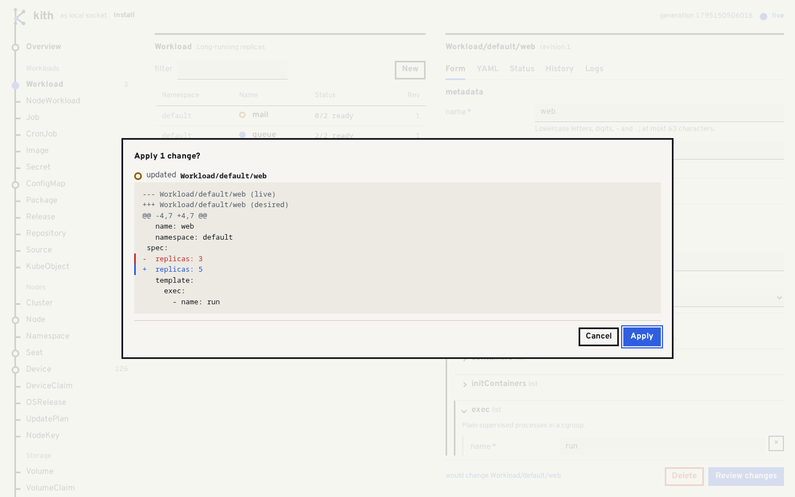
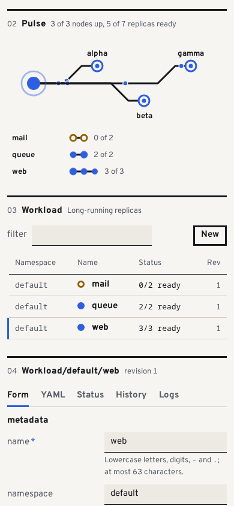

# Web UI

Every node serves a page that shows the cluster and changes it: what is running where, a form
for every kind (drawn from its schema, your own kinds included), the YAML beside it, status,
history with rollback, and output. An apply or a rollback shows its diff first; a delete asks.

<picture><source media="(prefers-color-scheme: dark)" srcset="../../docs/assets/screens/ui-review-dark.png"></picture>
<picture><source media="(prefers-color-scheme: dark)" srcset="../../docs/assets/screens/ui-phone-dark.png"></picture>

On a node, as its admin:
```sh
kith ui                 # prints http://127.0.0.1:PORT/SECRET/ui/ ; open it
kith ui --port 7000     # a port of your choosing
```

From your own machine, through SSH (`kith ui --port 7000` on the node, then):
```sh
ssh -L 7000:127.0.0.1:7000 node    # and open the printed address here
```

The address is the key: `kith ui` passes on only requests under that secret path, asked for
under this machine's own name, by its own page, and stops when you stop it. Keep it to yourself.

As an Identity, a browser can also open `https://kith:7443/ui/` on a node's TLS port and act as
that Identity, with what its Roles allow and no more. It needs the Identity's certificate
(`openssl pkcs12 -export -in alice.crt -inkey alice.key -out alice.p12`, imported into the
browser), `ca.crt` trusted, and the name `kith` pointing at a node (a line in `/etc/hosts`).

- The page is a few files inside kithd, open to all: everything it asks is not. No framework,
  nothing fetched from elsewhere (its content policy forbids it): it works with no internet.
- It asks kithd as you: the same API, rules and audit log as `kith` and `curl`; `POST /v1/diff`
  is the dry run it shows. A field the form cannot draw (a free-form object, `oneOf`) is a JSON
  box; the YAML tab edits anything.
- Not yet: logging in without a certificate (OIDC), secrets hidden until asked for, metrics.
